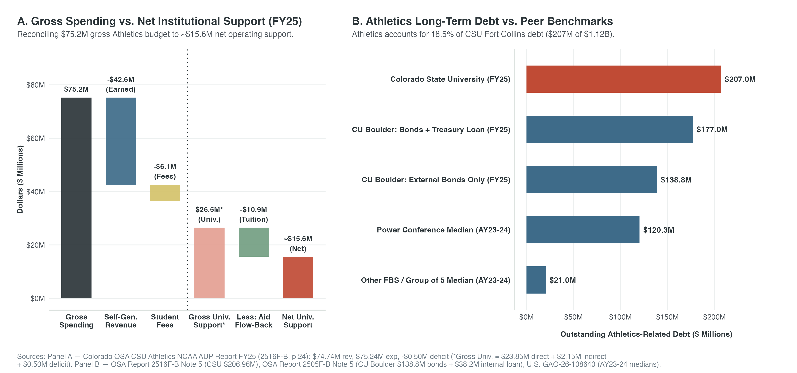

```{r setup}
source("src/report_helpers.R")

ath_hist   <- load_proc("athletics_ncaa_csu_fy19_fy25.csv")
ath_net    <- load_proc("athletics_gross_to_net_fy25.csv")
ath_debt   <- load_proc("athletics_debt_peers.csv")
black_swan <- load_proc("black_swan_math.csv")
audits     <- load_proc("real_audits_fy15_fy25.csv")
divs       <- load_proc("division_budget_shares_fy17_fy26.csv")

a25 <- ath_hist |> dplyr::filter(fiscal_year == 2025)
a20 <- ath_hist |> dplyr::filter(fiscal_year == 2020)
d26 <- divs |> dplyr::filter(fiscal_year == 2026)
d15 <- divs |> dplyr::filter(fiscal_year == 2015)
```

Placing a **\$75.24M gross Athletics budget** alongside a **\$61.3M–\$70.7M E&G operating gap** makes it natural to ask whether restructuring or reducing Athletics could close the university's shortfall. Audited filings from the Colorado Office of the State Auditor (`csu_ncaa_aup_fy19.pdf`–`fy25.pdf`, Report `2516F-B`) clarify both sides of that question: Athletics represents a real ongoing subsidy (`~15–20%` of Ledger B's multi-year structural pressures), yet gross expenditure numbers substantially overstate how much general-fund cash could be freed quickly.

::: {.figure-panel}
{width=100%}
:::

---

## 1. Reconciling Gross Spending (\$75.24M) to Net Institutional Support (~\$15.57M)

```{r tbl-ath-bridge}
ath_net |>
  dplyr::mutate(
    `FY25 Amount ($M)` = fmt_m(amount_m, 2, plus = TRUE)
  ) |>
  dplyr::select(Step = step_id, `FY25 Component (OSA Report 2516F-B)` = component, `FY25 Amount ($M)`, Category = category, Notes = note) |>
  csu_gt(
    title = "FY25 CSU Athletics Gross-to-Net Reconciliation",
    subtitle = "Reconciling $75.24M Total Expenditures to ~$15.57M Net Institutional Support (Excl. Bonded Debt Service)",
    source_note = "Source: Colorado OSA Statutory NCAA AUP Report 2516F-B (FY25); CSU Office of Budgets B2 E&G Allocation ($16.91M FY25 / $17.15M FY26)."
  )
```

Two accounting offsets narrow the \$75.24M headline figure to roughly **~\$15.57M per year** in net university operating support (~\$21.71M if dedicated student fees paid outside E&G are included):

1. **Self-Generated Revenue (\$42.60M, 57.0% of total revenue):** Ticket sales (\$8.17M), donor contributions (\$12.01M), conference/media/NCAA distributions (\$8.17M), sponsorships/royalties (\$6.70M), and game guarantees/concessions (\$7.54M) depend directly on operating NCAA programs.
2. **Tuition & Housing Flow-Back (\$10.93M):** Against \$23.85M in direct university support (anchored by `B2 Athletics` base E&G allocation of \$16.91M in FY25 and \$17.15M in FY26) plus \$2.15M indirect support and \$6.14M in mandatory student fees, Athletics returned **\$10.93M** to CSU for student-athlete tuition, fees, room, and board.

```{r tbl-ath-hist}
ath_hist |>
  dplyr::mutate(
    `Self-Gen. Rev` = fmt_m(self_generated_rev / 1e6, 2),
    `Univ. Support + Fees` = fmt_m(inst_plus_fees / 1e6, 2),
    `Support Share` = fmt_pct(inst_support_share, 1),
    `Total Expenses` = fmt_m(total_expenses / 1e6, 2),
    `Student Aid` = fmt_m(athletic_student_aid / 1e6, 2),
    `Fac/Debt Exp` = fmt_m(facilities_debt_service / 1e6, 2),
    `Ath. Debt` = fmt_m(athletics_debt / 1e6, 2)
  ) |>
  dplyr::select(`FY` = fiscal_year, `Self-Gen. Rev`, `Univ. Support + Fees`, `Support Share`, `Total Expenses`, `Student Aid`, `Fac/Debt Exp`, `Ath. Debt`) |>
  csu_gt(
    title = "Seven-Year Audited CSU Athletics Financial Trajectory (FY19–FY25 OSA Reports)",
    subtitle = "Expenses Increased +36.8% Since FY20 ($54.99M → $75.24M), While Bonded Athletics Debt Stands at $206.96M",
    source_note = "Sources: Colorado OSA NCAA AUP Reports csu_ncaa_aup_fy19.pdf through fy25.pdf (2516F-B)."
  )
```

---

## 2. Capital Debt Context: \$206.96M Athletics Debt Within a \$1.33B System Total

A defining feature of CSU's capital structure is long-term fixed debt incurred across both campus and auxiliary projects—including Canvas Stadium, CSU Spur, campus facilities, and FY25's **\$79.1M** STRATA ATLAS Laser bonds:

- **Fort Collins Debt Composition (`OSA 2516F-B`, Note 5, p. 26):** Of Fort Collins' \$1,118.77M total campus debt in FY25, **\$206.96M (18.5%)** is allocated to Athletics facilities (\$302.63M in total remaining principal + interest through maturity, with \$14.34M in FY25 debt service and leases; \$19.61M including direct facilities maintenance and equipment).
- **Comparative Scale:** **CU Boulder** (`OSA 2505F-B`, Note 5, p. 35) reported \$138.83M in external Athletics bonds (\$177.02M including a \$38.19M internal Treasury loan)—**9.6% of CU's \$1,850.29M debt** on \$161.67M in Athletics revenue. Federal **GAO-26-108640** data report AY23–24 medians of \$120.3M for Power-4 programs and \$21.0M for Other FBS / Group of 5 programs.
- **General-Fund Debt Service (`ColOBS`) & CSU Spur:** On Fort Collins' E&G ledger, central `XA Debt Service` grew from **\$10.17M (FY15)** to **\$31.86M (FY26)** (`+213%`), while FY27 Forum Slide 10 budgets **\$15.00M** for CSU Spur operations and programming (`$9.79M` operating + `$5.21M` program funded via BOG/SIFm).

```{r tbl-debt-peers}
ath_debt |>
  dplyr::mutate(`Bonded / Program Debt` = fmt_m(athletics_debt_m, 2)) |>
  dplyr::select(Entity = entity, `Bonded / Program Debt`, Scope = debt_type, Source = source_citation) |>
  csu_gt(
    title = "Athletics Long-Term Debt Comparison: CSU vs. CU Boulder & GAO Benchmarks",
    subtitle = "CSU Carries Higher Athletics Debt Than Power-4 Medians and Nearly 10x Non-Power FBS Medians",
    source_note = "Sources: Colorado OSA Reports 2516F-B & 2505F-B; U.S. GAO Report GAO-26-108640 (via nocapsports.io summary)."
  )
```

---

## 3. Common Campus Counterfactuals: Canceling Football or Winning an NCAA Run

::: {.callout-context}
**Why Neither Extreme Solves the FY28 Operating Gap:** Bond covenants remain legally payable regardless of football schedules, while NCAA tournament distributions are shared across conference members over six years.
:::

```{r tbl-black-swan-site}
black_swan |>
  dplyr::mutate(
    `Annual CSU Net Impact` = fmt_m(annual_to_csu_m, 2),
    `% of $66.0M FY28 Gap` = fmt_pct(pct_of_66m_gap, 1)
  ) |>
  dplyr::select(Scenario = scenario, `Annual CSU Net Impact`, `% of $66.0M FY28 Gap`, `Underlying Mechanics` = explanation) |>
  csu_gt(
    title = "Counterfactual Athletics Scenarios Against a $66.0M Midpoint FY28 Gap",
    subtitle = "Evaluated Using OSA Report 2516F-B Debt Schedules & NCAA Basketball Fund Distribution Rules",
    source_note = "Sources: Colorado OSA Report 2516F-B; NCAA Basketball Fund Unit Distribution Mechanics."
  )
```

- **Eliminating Football Operations:** Ending football would stop \$42.60M in self-generated revenues while recovering roughly ~\$15.6M in net institutional operating support (or up to \$17.2M `B2` E&G), **but \$206.96M in stadium/athletics bonded obligations (~\$10M+/yr debt service) would remain**, leaving roughly ~\$45M–\$50M of the FY28 E&G gap unresolved.
- **Postseason Tournament Success ("Cinderella Run"):** Reaching a Men's Basketball Final Four earns roughly 5 NCAA tournament units paid over six years (`~$1.70M/yr` at `~$340k/unit`), **divided equally across ~12 conference members**—roughly **\$142k/year net to CSU (`0.2%` of a \$66M gap)**. Even retaining 100% of 5 units without conference sharing (`~$1.70M/yr`) would offset `2.6%` of one year's shortfall.
