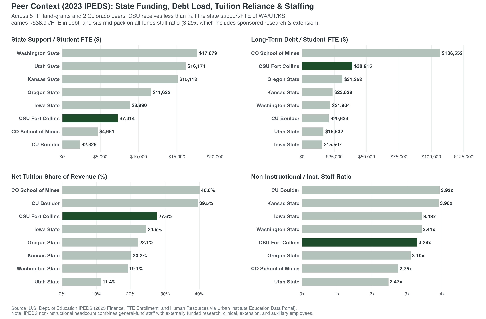

```{r setup}
source("src/report_helpers.R")

peers  <- load_proc("peer_benchmarks_2023.csv")
audits <- load_proc("real_audits_fy15_fy25.csv")
```

Working through a multi-year budget transition constructively depends on both listening to sincere campus concerns about institutional trust and checking circulating claims carefully against primary public records.

---

## 1. Governance & Trust Context vs. Source Verification

### Why Governance Transparency Matters Alongside the Math

1. **Late-2026 Presidential Transition Settlement (\$1.1M):** On Oct. 28, 2026, CSU announced President Amy Parsons' resignation effective Dec. 31, 2026 (prior contract ran to Jan. 2028 at \$600k/yr; Rick Miranda steps in as Interim President Jan. 1, 2027), alongside a **\$1.1M transition payout and mutual non-disparagement terms** criticized by AAUP-CSU on Nov. 5 (`aaupcsu.org`). While **\$1.1M** one-time equals **1.7%** of one year's \$66.0M FY28 operating projection, confidentiality terms around senior transitions understandably strain confidence when units across campus have just absorbed 160.58 permanent FTE reductions.
2. **Football Coaching Contract Scale (\$2.4M Base):** Head football coaching compensation (`$2.4M` starting base pay escalating to `$2.8M` over five years) and public post-game commentary drew understandable attention during a general-fund hiring slowdown—even though reducing coaching pay alone would address `<4%` of Ledger A.

### Source Verification Note: Title IX Investigator `Jeffrey Lamoureaux`

::: {.callout-context}
**Helpful Check Ahead of Late-2026 Meetings:** In fast-moving campus email discussions, it is easy for secondary summaries of national investigative reporting to get compressed. Several notes on campus have cited the hiring of Title IX investigator **Jeffrey Lamoureaux**, pointing to *San Francisco Chronicle* reporting as an example of local vetting failures. **Primary public records audited for this project do not show an employment link between Jeffrey Lamoureaux and CSU Fort Collins.**

- **What *San Francisco Chronicle* / UC Berkeley IRP reporting actually covered:** Former Burbank Police Sgt. Jeffrey Lamoureaux left law enforcement under a California "clean-record agreement" and subsequently worked as a Title IX investigator at **the University of Nebraska-Lincoln (UNL), Eastern Washington University, Appalachian State, Goodwin University, Auburn University, and the University of San Francisco**. Colorado appeared in that coverage because Colorado lawmakers passed legislation curbing similar police clean-record agreements—not because of CSU employment.
- **Why careful attribution helps everyone:** Grounding governance questions in verified Colorado filings—such as the \$1.1M non-disparagement payout, System debt trends (\$1.33B), and FY22–FY25 E&G hiring patterns (`Table 128`)—helps ensure valid institutional concerns are taken seriously across campus.
:::

---

## 2. How CSU Compares Across Colorado & Land-Grant R1 Peers (IPEDS FY23)

::: {.figure-panel}
{width=100%}
:::

```{r tbl-peers-full}
peers |>
  dplyr::arrange(dplyr::desc(is_csu), dplyr::desc(debt_per_fte)) |>
  dplyr::mutate(
    `Student FTE` = fmt_n(fte_best, 0),
    `State Support / FTE` = paste0("$", fmt_n(state_per_fte, 0)),
    `Long-Term Debt / FTE` = paste0("$", fmt_n(debt_per_fte, 0)),
    `Net Tuition % Rev` = fmt_pct(tuition_share_rev, 1),
    `Tuition Discount Rate` = fmt_pct(tuition_discount_rate, 1),
    `Research % Exp` = fmt_pct(research_share_exp, 1),
    `Non-Inst / Inst Staff` = paste0(formatC(noninst_to_inst_ratio, format = "f", digits = 2), "x"),
    `Total Debt` = fmt_m(debt_m, 1)
  ) |>
  dplyr::select(Institution = short_name, `Student FTE`, `State Support / FTE`, `Long-Term Debt / FTE`, `Total Debt`, `Net Tuition % Rev`, `Tuition Discount Rate`, `Research % Exp`, `Non-Inst / Inst Staff`) |>
  csu_gt(
    title = "IPEDS FY23 Cross-Institution Benchmark Table",
    subtitle = "Urban Institute IPEDS Harmonized Finance & HR Panel (2023 Reporting Cycle)",
    source_note = "Source: Urban Institute Education Data Portal IPEDS Finance & HR CSVs (2015–2023), peer_benchmarks_2023.csv."
  )
```

Three comparative patterns emerge from IPEDS FY23:

1. **Colorado State Funding Per FTE Trails Out-of-State Land-Grants:** At **\$7,314** in state appropriations and grants per student FTE, CSU receives roughly **half** the per-student state support of **Washington State (\$17,679/FTE)**, **Utah State (\$16,171/FTE)**, and **Kansas State (\$15,112/FTE)**—while still receiving more than 3× **CU Boulder (\$2,326/FTE)**. All three Colorado institutions rely substantially on tuition revenue (`27.6%` of current revenue at CSU; `39.5%` at CU Boulder; `40.0%` at Mines).
2. **CSU Carried Relatively High Long-Term Debt Per FTE (\$38,915/FTE):** Among comprehensive R1 land-grants in the peer group, CSU's \$38,915/FTE (`$1,118.6M` FY23 IPEDS debt) sits above Oregon State (`$31,252/FTE`), Kansas State (`$23,638/FTE`), Washington State (`$21,804/FTE`), CU Boulder (`$20,634/FTE`), Utah State (`$16,632/FTE`), and Iowa State (`$15,507/FTE`), trailing only specialized Colorado School of Mines (`$106,552/FTE`).
3. **CSU's All-Funds Staff Ratio (3.29x) Sits Mid-Pack:** CU Boulder (`3.93x`), Kansas State (`3.90x`), Iowa State (`3.43x`), and Washington State (`3.41x`) all report higher non-instructional-to-instructional IPEDS headcount ratios than CSU (`3.29x`). That reinforces why examining **general-fund (E&G) staffing patterns since FY22**—rather than all-funds IPEDS totals that mix externally funded research, clinical, and extension personnel—provides a fairer basis for discussion.

---

## 3. Constructive Questions Ahead of the FY28 Hybrid RCM Transition

In their Oct. 26, 2026 memo (alongside Faculty Fellows Rob Mitchell and Jennifer Martin), campus leadership noted candidly: ***"Changing the budget model will not by itself close a budget shortfall, nor does it produce new funding."*** With FY27 serving as the Parallel Year ahead of July 1, 2027 implementation, shared governance, deans, and administration have practical opportunities to focus questions on the structural drivers:

1. **Disaggregate Post-FY22 E&G Central VP Hiring (`864.8` FTE = `62.1%` of E&G AP):** Share clearer breakdowns showing how much of the `+326` E&G Admin Pro increase between FY22 and FY25 reflects student retention, compliance, IT security, or classified-to-AP conversions versus central administrative expansion—keeping externally funded research, clinical, and extension staff clearly separated.
2. **Co-Design Transparent FY28 Hybrid RCM Rules:** Publish clear parameters ahead of Dec. 3–4 BOG review covering "off-the-top" central assessments (`XA Debt Service $31.86M`, `CSU Spur $15.00M`), instructional credit-hour weights, and subvention mechanisms for foundational disciplines.
3. **Align Long-Term Athletics & Debt Planning With E&G Capacity:** Evaluate multi-year glide paths for CSU's ~\$15.6M net Athletics operating support (`B2 $17.15M` FY26 base) alongside cautious policies on any new bonded or internal treasury debt while general funds remain tight.
4. **Track Net Tuition Yield Alongside Enrollment Headcounts:** As campus recruits both resident and non-resident cohorts (`-9.7%` Dom NR UG in Fall 2026), evaluate net revenue per seat after institutional discounting (`$174.1M` System allowance / `21.3%` discount rate) alongside gross headcount goals.
