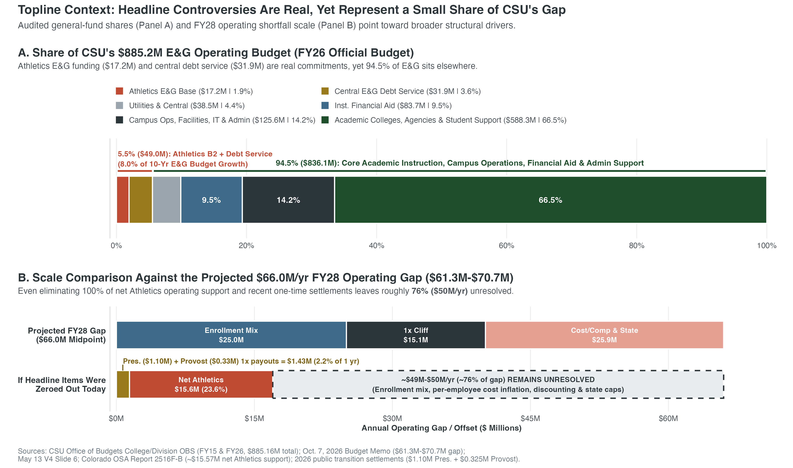

```{r setup}
source("src/report_helpers.R")

fy28 <- load_proc("fy28_shortfall_bridge.csv")
fy27 <- load_proc("fy27_v4_budget_bridge.csv")
wf   <- load_proc("eg_vs_noneg_workforce_totals.csv")
cem  <- load_proc("cemml_ap_unit_summary_fy25.csv")
apf  <- load_proc("ap_fte_by_detailed_fund_fy25.csv")
ath  <- load_proc("athletics_gross_to_net_fy25.csv")
ath7 <- load_proc("athletics_ncaa_csu_fy19_fy25.csv")
bdb  <- load_proc("bdb_real_fy17_fy27.csv")
bfn  <- load_proc("bdb_format20_functional_eg_fy15_fy27.csv")
fbc  <- load_proc("factbook_continuous_eg_fte_fy13_fy25.csv")
aud  <- load_proc("real_audits_fy15_fy25.csv")
top  <- load_proc("topline_takeaway_summary.csv")
man  <- load_manifest()

fn15 <- bfn |> dplyr::filter(fiscal_year == 2015)
fn26 <- bfn |> dplyr::filter(fiscal_year == 2026, status == "Actual")
fn27 <- bfn |> dplyr::filter(fiscal_year == 2027, status == "Estimate")
fc15 <- fbc |> dplyr::filter(fiscal_year == 2015)
fc25 <- fbc |> dplyr::filter(fiscal_year == 2025)
b15  <- bdb |> dplyr::filter(fiscal_year == 2015)
b26  <- bdb |> dplyr::filter(fiscal_year == 2026, status == "Actual")
au25 <- aud |> dplyr::filter(fiscal_year == 2025)
a25  <- ath7 |> dplyr::filter(fiscal_year == 2025)
noneg_ap_share <- sum(apf$fte_fy25[!apf$is_eg]) / sum(apf$fte_fy25)
tot_eg_fte_pct <- (fn26$tot_eg_fte - fn15$tot_eg_fte) / fn15$tot_eg_fte
stu_fte_pct    <- (b26$total_student_fte - b15$total_student_fte) / b15$total_student_fte
gen_admin_share <- fn26$inst_supp_fte / fn26$tot_eg_fte
```

::: {.callout-context}
**Topline Takeaway:** Structural debt, executive transition payouts (**\$1.10M** presidential + **\$325k** provost = **\$1.43M** one-time), and Athletics institutional support (**~\$15.57M/yr** net operating, **\$206.96M** bonded debt) are material components of Colorado State University's fiscal picture. Yet on CSU's **\$885.16M FY26 Education & General (E&G) budget**, Athletics E&G base support (`B2`: **\$17.15M**, **1.9%**) and central debt service (`XA`: **\$31.86M**, **3.6%**) represent **5.5% of the operating budget** and **8.0% of 10-year E&G growth (`FY15–FY26`)**. Eliminating 100% of net Athletics support and executive transition payouts would still leave **roughly `~$49M–$50M/yr` (~76%) of the projected `$66.0M` FY28 shortfall unresolved**, pointing toward broader structural drivers: non-resident enrollment mix (`-$25.0M`), expiring one-time stopgaps (`$15.11M`), rising tuition discounting (`21.3%`), flat state support prior to Nov. 2026 ballot reforms (`Amendment 87` / `Prop NN` relieve Medicaid and K-12 crowding on the General Fund though earmarked outside E&G), and cumulative per-employee compensation/benefit inflation (`$33.7M/yr` per `3%` pool) across an E&G workforce whose total headcount scaled in line with enrollment (`r fmt_pct(tot_eg_fte_pct, 1, TRUE)` E&G FTE vs. `r fmt_pct(stu_fte_pct, 1, TRUE)` Student FTE, `FY15–FY26`) while shifting toward academic/student support (`+39.9%`) and non-tenure-track instruction (`CCA +40.6%`, `Tenured -13.8%`).
:::

Ahead of the Nov. 30 AAUP chapter meeting, Dec. 1 Faculty Council, and Dec. 3–4 Board of Governors meetings, this reference separates **near-term FY28 operating mechanics (Ledger A)** from **multi-year structural context (Ledger B)** using **`r nrow(man)` archived primary public documents** logged in [`data/sources_manifest.csv`](data/sources_manifest.csv). High-level budget files cannot capture the operational value of specific campus services or teaching units; rather, these figures provide a common factual baseline across faculty, staff, deans, central administration, and the Board.

::: {.kpi-grid}
::: {.kpi-card .alert}
<div class="kpi-label">FY28 Projected E&amp;G Gap</div>
<div class="kpi-value">&#36;61.3M–&#36;70.7M</div>
<div class="kpi-sub">Pre-election Oct. 7 projection (&#36;25M enrollment mix, &#36;15.11M 1x cliff, &#36;21–&#36;31M cost/state); Nov. 3 Amend. 87 eases state General Fund pressure.</div>
:::

::: {.kpi-card .gold}
<div class="kpi-label">Athletics B2 + Debt in FY26 E&amp;G</div>
<div class="kpi-value">5.5% (&#36;49.0M)</div>
<div class="kpi-sub">Of &#36;885.16M FY26 E&amp;G: &#36;17.15M B2 Athletics (1.9%) + &#36;31.86M XA Debt (3.6%); 8.0% of 10-yr E&amp;G growth; ~&#36;50M/yr of FY28 gap remains even at &#36;0.</div>
:::

::: {.kpi-card}
<div class="kpi-label">Total E&amp;G FTE &amp; General Admin</div>
<div class="kpi-value">+7.0% | 6.4%</div>
<div class="kpi-sub">Total E&amp;G FTE grew +7.0% FY15–26 (matching +6.6% Student FTE). Central General Admin (Fmt 1600) is 6.4% of E&amp;G FTE (239.1 FTE; &#36;47.5M; 187.4 in FY27 Est.).</div>
:::

::: {.kpi-card}
<div class="kpi-label">Non-E&amp;G Admin Pro Share</div>
<div class="kpi-value">`r fmt_pct(noneg_ap_share, 1)`</div>
<div class="kpi-sub">Of 4,597.7 FY25 AP FTE, 3,205.5 work outside E&amp;G; even inside E&amp;G, 85.5% of AP staff work in advising, instruction, student &amp; research support.</div>
:::
:::

---

## Topline Scale: Headline Flashpoints vs. Total E&G & the FY28 Gap

::: {.figure-panel}
{width=100%}
:::

```{r tbl-topline-eg}
top |>
  dplyr::mutate(
    `Amount ($M)` = fmt_m(amount_m, 2),
    `Share` = fmt_pct(share_pct, 1),
    `10-Yr E&G Growth Share` = ifelse(is.na(growth_share_pct), "—", fmt_pct(growth_share_pct, 1))
  ) |>
  dplyr::select(Ledger = section, Component = item, `Amount ($M)`, Share, `10-Yr E&G Growth Share`, Source = source_citation) |>
  csu_gt(
    title = "Topline Fiscal Context: FY26 E&G Partition ($885.16M) & FY28 Gap Offset Ceiling ($66.0M Midpoint)",
    subtitle = "Quantifying Both Valid Governance Flashpoints and the Remaining Unsolved Structural Gap"
  ) |>
  gt::tab_row_group(label = "Panel B: Scale Against Projected FY28 Midpoint Shortfall ($66.0M)", rows = Ledger == "FY28 Gap Scale") |>
  gt::tab_row_group(label = "Panel A: Complete FY26 E&G Operating Budget Partition ($885.16M)", rows = Ledger == "FY26 E&G Budget") |>
  gt::cols_hide(columns = Ledger)
```

---

## Two Ledgers: Near-Term Variance vs. Multi-Year Structure

Campus discussions often conflate **annual operating variances** with **decade-scale cost structure**. Separating the two ledgers clarifies how each factor contributes:

```{r tbl-two-ledgers}
ledger_cmp <- tibble::tibble(
  Dimension = c(
    "Core Question",
    "Dollar Scale",
    "Primary Drivers",
    "Executive Payouts ($1.43M Combined)",
    "Athletics ($75.2M Gross Budget)",
    "Externally & Self-Funded Staff"
  ),
  `Ledger A: Immediate FY28 Gap` = c(
    "What changes CSU's E&G budget from FY27 ($901.0M) to FY28?",
    "$61.3M – $70.7M ($66.0M midpoint pre-election)",
    "1) Enrollment/NR tuition drop (~$25.0M); 2) Expiring FY27 one-time bridges ($15.11M); 3) Comp/utilities vs. state funding ($21.2M–$30.6M; Nov. 3 Amend. 87 eases state GF crowding).",
    "One-time $1.10M presidential + $0.325M provost settlements equal 2.2% of one year's midpoint gap ($0 recurring).",
    "Minimal year-over-year change unless net university transfers expand.",
    "Do not drive the E&G shortfall; funded by grants, contracts, clinical fees & auxiliaries (incl. up to $36.5M CSFS from Prop 137)."
  ),
  `Ledger B: Multi-Year Structural Context` = c(
    "Why is CSU's general fund tightly constrained during a -2.5% enrollment dip?",
    "Illustrative: ~45% E&G Payroll/Model; ~22% Debt; ~17% Athletics Net; ~16% State/Aid",
    "Cumulative comp/benefit inflation on incremental bases ($33.7M per 3% pool), Academic/Student Support expansion (+39.9%), doubled System debt ($1.33B), and a 21.3% discount rate—despite flat total E&G FTE (+7.0% vs. +6.6% Student FTE).",
    "Material governance & transparency issue rather than a core recurring financial driver.",
    "Meaningful ~17% structural pressure (~$15.6M net operating support) + $206.96M bonded debt.",
    "Account for 69.7% of all AP FTE; inside E&G, 85.5% of AP staff work outside Central General Admin (Fmt 1600 = 239.1 FTE)."
  )
)

csu_gt(
  ledger_cmp,
  title = "Two Separate Ledgers for Examining CSU's Budget Position",
  subtitle = "Distinguishing Near-Term FY28 Drivers from Multi-Year Structural Pressures",
  source_note = "Sources: Oct. 7, 2026 Budget Update; May 13, 2026 V4 Forum; CDHE BDBs FY15–27; Fact Book FY26/FY27; OSA Report 2516F-B; 2026 CO Blue Book."
) |>
  gt::cols_width(
    Dimension ~ gt::px(190),
    `Ledger A: Immediate FY28 Gap` ~ gt::px(330),
    `Ledger B: Multi-Year Structural Context` ~ gt::px(330)
  )
```

---

## Verification Architecture & Primary-Source Safeguards

::: {.callout-audit}
**Reproducibility & Methodological Verification:** This reference site and companion PDF brief run on an open-source, deterministic **R (`4.5.2`) + Quarto (`1.10`)** pipeline ([`src/00`–`src/05`](methodology-sources.qmd)), initiated and reviewed with **Google DeepMind’s Antigravity** coding agent. Five substantive engineering and accounting safeguards anchor every calculation:

1. **Deterministic Code Over Checksummed Filings:** Zero numbers come from language-model memory or manual guesswork. Every figure is computed programmatically from **`r nrow(man)` archived primary public filings, ballot fiscal notes, and federal/BLS API extracts** logged with exact URLs and SHA-256 digests in [`data/sources_manifest.csv`](data/sources_manifest.csv).
2. **Isolating General-Fund (`E&G`) Positions From Self-Supporting Grants & Auxiliaries:** Federal and service enterprises account for **69.7% (`3,205.5` of `4,597.7`)** of Campus Administrative Professional FTE (`Fact Book Table 123–124`) and are funded outside E&G tuition and state appropriations.
3. **Disaggregating HR Job Codes by Actual Function & Controlling Title Shifts:** Rather than reading raw `"Admin Pro"` or active-rank counts at face value, the pipeline cross-checks `CDHE Formats 20, 25, 30 & 1100–1700` and continuous `Fact Book FY26` series—isolating `-254.6` `State Classified -> AP/Recharge` conversions, `2018–19` `Special/Temporary -> CCA` faculty rank formalization, and the actual functional distribution of E&G AP staff (`326.4` FTE directly in `Instruction`, `484.1` in `Academic Support`, and `204.8` in `Student Services` vs. `213.2` AP / `239.1` total FTE in `Format 1600` Central General Administration).
4. **Controlling Accounting Transfers & Gross-vs.-Net Offsets:** Historical `ColOBS` division tables control explicitly for FY19's **\$41.64M** aid move (`XA` to `P1`) and FY26's **~\$111.26M** pooled fringe decentralization, while statutory Colorado OSA reports (`2516F-B`) reconcile `$75.24M` gross Athletics spending down to `~$15.57M` net institutional operating support.
5. **Cross-Ledger Triangulation, Post-Election Context & Automated Build Assertions (`src/05_verify_audit.R`):** Claims across campus stakeholders are verified against primary records—including the Nov. 3, 2026 Colorado Blue Book fiscal notes (`Amendment 87`, `Prop NN`, `Prop 137`), `$1.43M` combined transition settlements, and zero CSU employment record tying external Title IX consultant Jeff Lamoureux to Fort Collins—while automated assertions check every balance and functional identity on every build. Full details appear on **[Verification & Primary Sources](methodology-sources.qmd)**.
:::

---

## Guide to Sections

1. **[Ledger A: FY28 Gap](ledger-a-fy28-cliff.qmd)** audits the pre-election `$61.3M–$70.7M` projection against Fall 2026 census shifts (`-2.5%` RI enrollment, `-9.7%` Domestic Non-Resident UG), FY27 V4 closeout actions (`$15.112M` expiring one-time stopgaps and `160.58` permanent FTE cuts), and **November 3, 2026 Colorado ballot fiscal impacts** (`Amendment 87 +$1.97B`, `Prop NN +$521M`, `Prop 137 $175M`).
2. **[Ledger B: Structural Context](ledger-b-structural.qmd)** presents the full E&G vs. Non-E&G separation (`69.7%` outside E&G), continuous E&G workforce vs. enrollment balance (`+7.0%` vs. `+6.6%`), **functional disaggregation of E&G staff who teach (`326.4` AP FTE in `Instruction`) vs. Central General Admin (`239.1` FTE = `6.4%` in `Format 1600`)**, tuition discounting (`21.3%`), and state TABOR constraints.
3. **[Athletics & Debt](athletics-audit.qmd)** reconciles the `$75.24M` gross Athletics budget down to `~$15.57M` net institutional support, details CSU's `$206.96M` Athletics bonded debt (`18.5%` of campus debt), and evaluates football discontinuation and NCAA postseason scenarios.
4. **[Governance & Peers](governance-and-peers.qmd)** reviews the `$1.10M` presidential and `$325k` provost transition settlements, football contract scale (`$2.4M` base + UConn buyout/assistant pool), the Title IX verification note on Jeff Lamoureux, and IPEDS FY23 peer benchmarks across 7 Colorado and land-grant institutions.
5. **[Verification & Primary Sources](methodology-sources.qmd)** documents the verification pipeline, accounting scope rules, `DATA_GAPS.md`, and all `r nrow(man)` archived primary sources.

::: {.callout-audit}
**Downloadable Brief:** A formatted **[PDF Brief (Understanding CSU's FY27–28 Budget Gap)](outputs/pdf/CSU_Budget_Context_FY27_28.pdf)** is available for committee packets or offline reference.
:::
