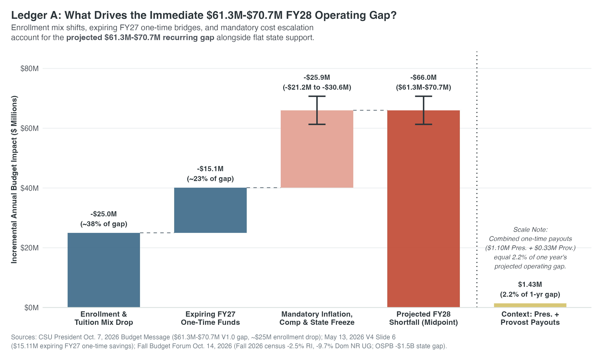

```{r setup}
source("src/report_helpers.R")

fy28   <- load_proc("fy28_shortfall_bridge.csv")
fy27   <- load_proc("fy27_v4_budget_bridge.csv")
cuts   <- load_proc("fy27_fte_cuts_by_unit.csv")
census <- load_proc("fall_census_enrollment_2019_2026.csv")
bdb    <- load_proc("bdb_real_fy17_fy27.csv")
obs    <- load_proc("obs_state_approp_fy24_fy27.csv")

c25 <- census |> dplyr::filter(fall_year == 2025)
c26 <- census |> dplyr::filter(fall_year == 2026)
```

Before evaluating long-term structural options, it is essential to measure **what drives the immediate \$61.3M–\$70.7M (\$66.0M midpoint) projected operating gap in FY28**. Every figure on this page is traced directly to CSU's Oct. 7, 2026 campus budget update, Oct. 14, 2026 Fall Budget Forum census slides, and May 13, 2026 Campus V4 FY27 budget materials.

::: {.figure-panel}
{width=100%}
:::

```{r tbl-fy28-bridge}
fy28 |>
  dplyr::mutate(
    `Range ($M)` = ifelse(low_m == high_m, fmt_m(mid_m, 2), paste0(fmt_m(low_m, 2), " – ", fmt_m(high_m, 2))),
    `Midpoint ($M)` = fmt_m(mid_m, 2),
    `Share of Midpoint` = ifelse(step_order <= 3, fmt_pct(mid_m / 66.00, 1), "100.0%")
  ) |>
  dplyr::select(
    Step = step_order,
    `Incremental FY28 Driver` = driver,
    `Range ($M)`,
    `Midpoint ($M)`,
    `Share of Midpoint`,
    Category = type,
    `Primary Documentation` = source_citation
  ) |>
  csu_gt(
    title = "Ledger A: Decomposed Incremental Drivers of CSU's Projected FY28 E&G Gap",
    subtitle = "Reconciled Against Oct. 7 Campus Update & May 13 V4 Forum Materials"
  )
```

---

## 1. Enrollment Shifts & Higher-Margin Non-Resident Mix (~\$25.00M)

CSU's Fall 2026 census reflects a dual trend: **campus welcomed a record incoming class of Colorado resident students and raised its 4-year graduation rate from 51.1% to 55.1%, even as total Resident Instruction (RI) tuition revenue fell.**

Two mechanics explain that outcome:
1. **Stronger 4-Year Completion:** Graduating more students in four years (`51.1% → 55.1%`) represents a notable academic achievement for students and families, while mechanically reducing the pool of continuing fifth-year tuition-paying undergraduates.
2. **Non-Resident & International Contraction:** Non-resident students pay roughly triple in-state rates and contributed **48.7% of CSU's Format 30 E&G tuition (\$268.9M in FY26) on 33.1% of student FTE**. In Fall 2026, **Domestic Non-Resident Undergraduates declined -9.7% (-685 students)**, **International Undergraduates fell -6.7%**, and **International Graduate enrollment fell -13.9%**, creating an estimated **~\$25.00M** net revenue reduction (`Oct. 7 Memo`; `Oct. 14 Slides 4–6`).

```{r tbl-fall-census}
census |>
  dplyr::mutate(
    `RI Headcount` = fmt_n(ri_total, 0),
    `RI Credit Hours` = fmt_n(ri_credit_hours, 0),
    `RI FTE` = fmt_n(ri_fte, 1),
    `All-Campus Headcount` = fmt_n(total_all_campus, 0),
    `UG (All)` = fmt_n(ug_total_all, 0),
    `Grad (All)` = fmt_n(grad_total_all, 0),
    `CSU Online (LI)` = fmt_n(learning_innov, 0)
  ) |>
  dplyr::select(`Fall Term` = fall_year, `RI Headcount`, `RI Credit Hours`, `RI FTE`, `UG (All)`, `Grad (All)`, `CSU Online (LI)`, `All-Campus Headcount`) |>
  csu_gt(
    title = "Fall Census Headcount & Resident Instruction (RI) Credit-Hour Trends, 2019–2026",
    subtitle = paste0(
      "Fall 2026 vs. Fall 2025: RI Headcount ", fmt_n(c26$ri_total - c25$ri_total, 0, TRUE),
      " (-2.5%), RI Credit Hours ", fmt_n(c26$ri_credit_hours - c25$ri_credit_hours, 0, TRUE), " (-2.6%)"
    ),
    source_note = "Sources: CSU Fact Book FY27 (2019–2025) & Oct. 14, 2026 Fall Budget Forum Slides 4–6 (Fall 2026 census)."
  )
```

---

## 2. Expiring FY27 One-Time Bridge Funds (\$15.11M)

Examining how CSU closed FY27's **\$54.272M** V4 budget gap (`Campus-V4-5-13-2026_a-1.pdf`, Slides 5–6) clarifies why FY28 starts with an automatic carry-forward deficit:

- FY27 new expenses totaled **\$61.103M** (including **\$33.665M** for the 3% faculty/AP/GA compensation pool, state classified mandates, and fringe benefits; **\$8.826M** multi-year strategic investments; **\$8.120M** academic incentives; and **\$8.678M** mandatory cost escalation).
- Net new resources provided **\$6.831M** (`$11.860M` net rate/enrollment impact minus `-$5.029M` institutional aid offset), leaving **-\$54.272M** to resolve.
- Campus closed **\$39.160M** through recurring adjustments (`$7.406M` central savings, `$28.754M` campus unit reductions, and `$3.000M` vacant line reductions) and bridged the remaining **\$15.112M with one-time savings** that expire on June 30, 2027.

```{r tbl-fy27-v4}
fy27 |>
  dplyr::mutate(
    `Amount ($M)` = fmt_m(amount_m, 3, plus = TRUE)
  ) |>
  dplyr::select(Section = section, `Budget Line Item` = line_item, `Amount ($M)`, Notes = notes) |>
  csu_gt(
    title = "FY27 Campus V4 Incremental Budget Bridge (May 13, 2026 Forum)",
    subtitle = "Expiring One-Time Savings ($15.112M) Automatically Re-Enter the FY28 Baseline Calculation",
    source_note = "Source: Campus-V4-5-13-2026_a-1.pdf, Slides 5–6."
  ) |>
  gt::tab_row_group(label = "Balancing Actions (+$54.272M)", rows = Section == "Balancing Actions") |>
  gt::tab_row_group(label = "New Expenses (-$61.103M)", rows = Section == "New Expenses") |>
  gt::tab_row_group(label = "New Resources (+$6.831M)", rows = Section == "New Resources") |>
  gt::cols_hide(columns = Section)
```

---

## 3. Mandatory Cost Escalation, Compensation & State Budget Context (\$21.19M–\$30.59M)

Under the Board of Governors' three initial FY28 scenarios (modeling 0%, 1%, and 3% state funding increases alongside matching compensation assumptions), health insurance, utilities, classified step mandates, and salary pools on a **\$900.98M** State Appropriated / E&G base add **\$21.19M to \$30.59M** net of anticipated state support.

Meanwhile, Colorado's September 2026 OSPB economic forecast projects a state general-fund shortfall of up to **\$1.5B** in FY28, largely absorbed by Medicaid obligations (`Oct. 7 Memo`), keeping CSU's state Fee-for-Service and COF support essentially flat at **\$211.05M (23.4% of State Appropriated / E&G revenue in FY27)**.

---

## Distribution of FY27's 160.58 Permanent FTE Reductions

May 13 V4 Forum disclosures (Slides 7–8) document that FY27 permanent reductions spanned units across campus: **160.58 permanent FTE** were reduced across 30 units, comprising **91.84 Admin Pro FTE (57.2%)**, 28.60 State Classified (17.8%), 22.62 Non-TTF (14.1%), and 17.52 TTF (10.9%)—spanning academic colleges (`Liberal Arts 18.59 FTE`, `CVMBS & PVM 14.85 FTE`, `Engineering 14.17 FTE`) as well as administrative and athletics divisions (`VP University Operations 10.35 FTE`, `VP Marketing & Comms 7.20 FTE`, `Athletics 4.40 AP FTE`).

```{r tbl-fy27-cuts}
cuts |>
  dplyr::arrange(dplyr::desc(total_fte)) |>
  dplyr::mutate(
    `State Class.` = fmt_n(state_classified, 2),
    `TTF` = fmt_n(ttf, 2),
    `Non-TTF` = fmt_n(non_ttf, 2),
    `Admin Pro` = fmt_n(admin_pro, 2),
    `Total Cut FTE` = fmt_n(total_fte, 2)
  ) |>
  dplyr::select(Unit = unit_division, Category = unit_type, `State Class.`, TTF, `Non-TTF`, `Admin Pro`, `Total Cut FTE`) |>
  csu_gt(
    title = "FY27 Permanent FTE Reductions by Campus Unit (May 13, 2026 V4 Closeout)",
    subtitle = "Total: 160.58 Permanent FTE Across Academic Colleges, Agencies, and Support Units",
    source_note = "Source: Campus-V4-5-13-2026_a-1.pdf, Slides 7–8."
  )
```

::: {.callout-audit}
**Ledger A Summary:** Even holding recent executive transition payouts (`$1.43M` combined one-time) and coaching compensation changes at `$0`, FY28's enrollment mix impact (`~$25.0M`), expiring FY27 one-time bridge funds (`$15.11M`), and mandatory compensation/utility escalation (`$21.19M–$30.59M`) account for **virtually the entire `$61.3M–$70.7M` incremental projection**.
:::
