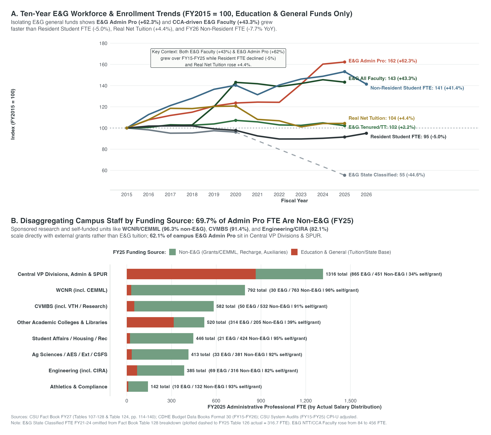

```{r setup}
source("src/report_helpers.R")

pie       <- load_proc("structural_blame_pie.csv")
wf        <- load_proc("eg_vs_noneg_workforce_totals.csv")
ap_fund   <- load_proc("ap_fte_by_detailed_fund_fy25.csv")
cemml     <- load_proc("cemml_ap_unit_summary_fy25.csv")
ap_units  <- load_proc("ap_fte_by_unit_fy25.csv")
bdb       <- load_proc("bdb_real_fy17_fy27.csv")
obs       <- load_proc("obs_state_approp_fy24_fy27.csv")
divs      <- load_proc("division_budget_shares_fy17_fy26.csv")
audits    <- load_proc("real_audits_fy15_fy25.csv")

f15 <- wf |> dplyr::filter(fiscal_year == 2015)
f22 <- wf |> dplyr::filter(fiscal_year == 2022)
f25 <- wf |> dplyr::filter(fiscal_year == 2025)
```

While Ledger A explains the immediate FY28 gap, **Ledger B** examines the longer-term constraints between FY15 and FY26 that left CSU's Education & General (E&G) operating base with thin reserves to absorb a -2.5% fall enrollment decline.

::: {.figure-panel}
{width=100%}
:::

```{r tbl-blame-pie}
pie |>
  dplyr::mutate(
    `Estimated Weight` = paste0(low_pct, "% – ", high_pct, "% (mid ", mid_pct, "%)")
  ) |>
  dplyr::select(Group = bucket_order, `Structural Factor` = driver, `Estimated Weight`, `Audited Primary Anchor` = audited_anchor, `Accounting Scope` = methodology_note) |>
  csu_gt(
    title = "Ledger B: Multi-Year Structural Pressure Weights",
    subtitle = "Strictly Partitioned So Capital Debt and Operating Subsidies Are Not Double-Counted",
    source_note = "Sources: CSU Fact Book FY27, CDHE Format 30 BDBs, Audits FY15–FY25, Colorado OSA Report 2516F-B."
  )
```

---

## 1. Workforce Context & Separating Soft-Money Research (CEMML / CIRA / VTH)

### Why All-Funds Headcount Ratios Require Fund Disaggregation

Broad critiques pointing to CSU's all-funds staff-to-faculty ratio (~3:1 in IPEDS and campus totals) often combine **grant-funded research staff** with **general-fund (E&G) administrative roles**. At a major R1 land-grant institution, large self-supporting research and clinical units—such as Warner College's **Center for Environmental Management of Military Lands (CEMML)**, Engineering's **CIRA**, the **Veterinary Teaching Hospital (VTH)**, and Extension/Forest Service units—expand and contract directly alongside external contracts and federal/state awards rather than drawing on undergraduate tuition.

CSU Fact Book FY27 (Tables 122–124 & 128) allows a clean separation between **E&G** general funds and **Non-E&G** enterprise/grant funds:

```{r tbl-ap-fund}
ap_fund |>
  dplyr::mutate(
    `FY25 AP FTE` = fmt_n(fte_fy25, 1),
    `Share of Total AP` = fmt_pct(share, 1),
    `Funding Classification` = ifelse(is_eg, "E&G General Fund (Tuition / State)", "Non-E&G (Grants, Recharge, Auxiliaries, Other)")
  ) |>
  dplyr::select(`Funding Group` = fund_group, `FY25 AP FTE`, `Share of Total AP`, `Funding Classification`) |>
  csu_gt(
    title = "FY25 Administrative Professional FTE by Funding Source (Fact Book FY27 Table 123)",
    subtitle = "69.7% of Campus AP Personnel Work Outside E&G on External Grants, Recharge Centers, or Auxiliaries",
    source_note = "Source: CSU_Factbook_FY27_2026-10-22.pdf, Table 123 (p. 142)."
  )
```

```{r tbl-cemml-units}
cemml |>
  dplyr::mutate(
    `E&G AP FTE` = fmt_n(eg_fte, 1),
    `Non-E&G AP FTE` = fmt_n(other_funds_fte, 1),
    `Total AP FTE` = fmt_n(total_fte, 1),
    `% Non-E&G (Grant/Self-Funded)` = fmt_pct(non_eg_share, 1),
    `Share of Campus E&G AP` = fmt_pct(eg_share_of_campus_eg, 1)
  ) |>
  dplyr::select(`Organizational Group` = macro_bucket, `E&G AP FTE`, `Non-E&G AP FTE`, `Total AP FTE`, `% Non-E&G (Grant/Self-Funded)`, `Share of Campus E&G AP`) |>
  csu_gt(
    title = "Where CSU's Administrative Professional Personnel Sit by Unit & Fund (Fact Book FY27 Table 124)",
    subtitle = "WCNR/CEMML Is 96.3% Non-E&G; Central VP Divisions & SPUR Hold 62.1% of Campus E&G AP Capacity",
    source_note = "Source: CSU_Factbook_FY27_2026-10-22.pdf, Table 124."
  )
```

::: {.callout-context}
**Key Distinction on Research Units:** In FY25, **WCNR (including CEMML)** employs `792.5` AP FTE, of whom **`762.9` FTE (`96.3%`) are non-E&G funded** and just `29.6` FTE (`2.1%` of campus E&G AP) sit on E&G. Likewise, CVMBS (`91.4%` non-E&G), Ag Sciences/AES/Ext/CSFS (`92.1%`), and Engineering/CIRA (`82.1%`) are predominantly externally or clinically funded. Meanwhile, **Central VP Divisions, Administration & CSU Spur** house **`864.8` of CSU's `1,392.2` E&G AP FTE (`62.1%`)**.
:::

---

### What E&G-Only Trends Show Across Both Administrative and Academic Units

Once externally funded staff are set aside and we examine **E&G general-fund positions alone** between FY15 and FY25, the data reveal a shared pattern across both administration and academic instruction:

::: {.figure-panel}
{width=100%}
:::

1. **E&G Admin Pro Rose +62.3% (+534.5 FTE, 858.1 → 1,392.6), Including +326.3 FTE (+30.6%) After FY22:** Part of this increase reflects state-classified-to-AP conversions (as E&G State Classified FTE declined by -254.6 FTE, from 571.3 to 316.7), while post-FY22 hiring added +326.3 E&G AP FTE between FY22 and FY25 (`1,066.3 → 1,392.6`).
2. **E&G Faculty Expanded +43.3% (+390.0 FTE, 901.0 → 1,291.0) Through NTT/CCA Formalization:** Tenured and tenure-track E&G faculty remained nearly steady (`817.3 → 835.4`, `+2.2%`), while **Non-Tenure-Track / CCA & Adjunct E&G faculty grew from 83.7 to 455.6 FTE (+444.3%)** as continuing and contract faculty appointments were formalized, alongside +249.7 E&G graduate assistant FTE (`+35.4%`).
3. **Enrollment & Real Net Tuition Grew Much More Slowly:** Over FY15–FY26 actuals, CDHE Resident Student FTE declined **-5.0%** (`17,535.0 → 16,664.2`), while CPI-adjusted **CSU System real net tuition ended FY25 +4.4% above FY15** (`$617.9M → $644.9M` in `FY25$`, down `-13.5%` from FY20's real peak of `$746.0M`). Under CSU's legacy incremental budget model (`Oct. 26 Memo`; `Operations guide`), historical headcount bases rolled forward year-to-year with limited responsiveness to credit-hour shifts.

```{r tbl-eg-wf-long}
wf |>
  dplyr::mutate(
    `E&G Admin Pro` = fmt_n(eg_admin_pro, 1),
    `E&G Total Faculty` = fmt_n(eg_faculty_total, 1),
    `E&G TTT` = fmt_n(eg_faculty_ttt, 1),
    `E&G NTT/CCA` = fmt_n(eg_faculty_ntt, 1),
    `E&G Classified*` = fmt_n(eg_state_class, 1),
    `E&G Total (incl. GA)` = fmt_n(eg_all_incl_ga, 1),
    `Non-E&G All Funds` = fmt_n(other_all_fte, 1),
    `All-Funds FTE` = fmt_n(total_all_funds_fte, 1)
  ) |>
  dplyr::select(`Fiscal Year` = fiscal_year, `E&G Admin Pro`, `E&G Total Faculty`, `E&G TTT`, `E&G NTT/CCA`, `E&G Classified*`, `E&G Total (incl. GA)`, `Non-E&G All Funds`, `All-Funds FTE`) |>
  csu_gt(
    title = "10-Year CSU Fort Collins Workforce Trajectory by Fund Type (FY15–FY25)",
    subtitle = "E&G Payroll Growth vs. Non-E&G Grant/Auxiliary Staff (*Table 128 omits FY21–FY24 E&G Classified rows; left NA)",
    source_note = "Source: CSU_Factbook_FY27_2026-10-22.pdf, Tables 122, 123, and 128."
  )
```

<details>
<summary><strong>Expand to view all 42 Fact Book Table 124 units (E&amp;G vs. Non-E&amp;G FY25 AP FTE)</strong></summary>

```{r tbl-ap-42}
ap_units |>
  dplyr::arrange(dplyr::desc(eg_fte)) |>
  dplyr::mutate(
    `E&G AP` = fmt_n(eg_fte, 1),
    `Non-E&G AP` = fmt_n(other_funds_fte, 1),
    `Total AP` = fmt_n(total_fte, 1),
    `Non-E&G %` = fmt_pct(non_eg_share, 1)
  ) |>
  dplyr::select(Unit = unit, Group = unit_category, `E&G AP`, `Non-E&G AP`, `Total AP`, `Non-E&G %`) |>
  csu_gt(
    title = "FY25 Administrative Professional FTE Across All 42 Fact Book Table 124 Units",
    subtitle = "Ordered by E&G General-Fund FTE Footprint"
  )
```

</details>

---

## 2. State Funding Limits, Tuition Discounting & Research F&A Mechanics

::: {.figure-panel}
{width=100%}
:::

Three structural revenue constraints help explain why strong campus activity—like rising grant totals and full teaching loads—does not automatically eliminate an E&G operating gap:

1. **Higher Institutional Tuition Discounting:** In CSU System audited financial statements (`audits_system_fy15_fy25`), scholarship allowances increased from \$114.4M (19.9% discount rate in FY15; 17.9% in FY17) to **\$174.1M (21.3% discount rate) in FY25**. Within Fort Collins E&G budgets (`bdb_real_fy17_fy27`), institutional aid grew from \$47.2M (FY15) to \$88.5M (FY26) and **\$96.3M estimated for FY27**, offsetting part of headline tuition rate increases (`3.5%` resident / `4.0%` NR / `3.5%` differential in FY27).
2. **State Funding Constraints:** In FY27 (`obs_state_approp_fy24_fy27`), State Fee-for-Service (\$161.60M) and COF stipends (\$49.45M) supply **\$211.05M (23.4% of the \$900.98M State Appropriated / E&G budget)**—virtually flat versus FY26 (\$210.94M) under Colorado's TABOR limits and state Medicaid pressures.
3. **Why Sponsored Research Grants Do Not Directly Cross-Subsidize E&G Instruction:** CSU System grants and contracts reached **\$548.0M** in FY25 (`audits`) and Fort Collins Indirect Cost Recovery (IDCR) reached **\$76.0M** (`obs`). However, federal F&A recovery partially reimburses dedicated research compliance, startup packages, cost-share commitments, and lab infrastructure rather than generating surplus cash for general undergraduate instruction. Similarly, higher teaching loads in discounted resident programs add instructional workload with lower net margin than non-resident enrollment.

```{r tbl-colobs-breaks}
obs |>
  dplyr::mutate(
    `State FFS` = fmt_m(state_ffs / 1e6, 2),
    `State COF` = fmt_m(state_cof / 1e6, 2),
    `State Total` = fmt_m(state_total / 1e6, 2),
    `State %` = fmt_pct(state_total / state_approp_total, 1),
    `Tuition Approp.` = fmt_m(tuition_state_approp / 1e6, 2),
    `IDCR (F&A)` = fmt_m(idcr / 1e6, 2),
    `Total State Approp. Budget` = fmt_m(state_approp_total / 1e6, 2)
  ) |>
  dplyr::select(`Fiscal Year` = fiscal_year, `State FFS`, `State COF`, `State Total`, `State %`, `Tuition Approp.`, `IDCR (F&A)`, `Total State Approp. Budget`) |>
  csu_gt(
    title = "CSU Fort Collins State Appropriated / E&G Revenue Mix (FY24–FY27 Original Budgets)",
    subtitle = "State Funding Remained Near $211M (23.4%) as Base Costs Expanded Toward $901M",
    source_note = "Source: CSU Office of Budgets FY24–FY27 Operating Budget Summaries."
  )
```

*(Comparability Note: In Office of Budgets ColOBS tables, \$41.64M of institutional financial aid moved from `XA Central` into `P1 Enrollment & Access` in FY19, and ~\$111.26M of centrally pooled `XA Employee Fringe Benefits` decentralized across academic and support units in FY26. Figure 5 controls for both shifts explicitly so accounting transfers are not mistaken for organic spending spikes.)*
