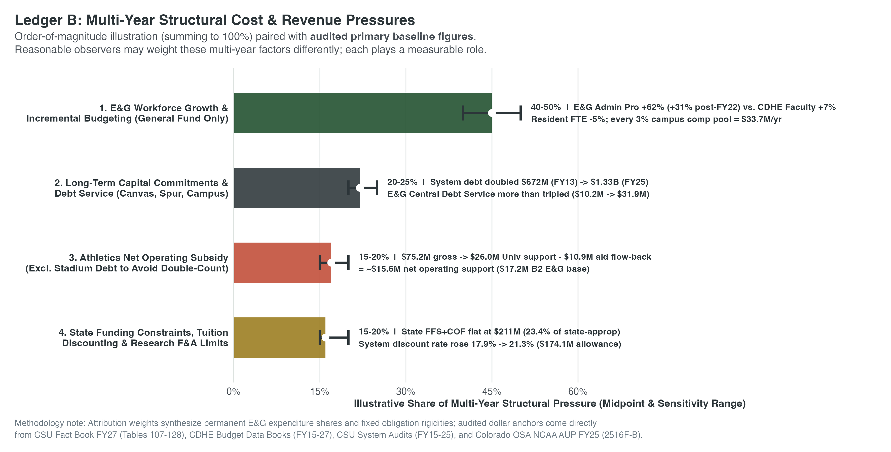
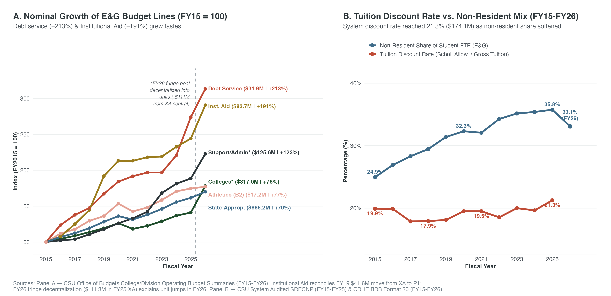

```{r setup}
source("src/report_helpers.R")

pie       <- load_proc("structural_blame_pie.csv")
wf        <- load_proc("eg_vs_noneg_workforce_totals.csv")
ap_fund   <- load_proc("ap_fte_by_detailed_fund_fy25.csv")
cemml     <- load_proc("cemml_ap_unit_summary_fy25.csv")
ap_units  <- load_proc("ap_fte_by_unit_fy25.csv")
bdb       <- load_proc("bdb_real_fy17_fy27.csv")
obs       <- load_proc("obs_state_approp_fy24_fy27.csv")
divs      <- load_proc("division_budget_shares_fy17_fy26.csv")
audits    <- load_proc("real_audits_fy15_fy25.csv")

f15 <- wf |> dplyr::filter(fiscal_year == 2015)
f20 <- wf |> dplyr::filter(fiscal_year == 2020)
f22 <- wf |> dplyr::filter(fiscal_year == 2022)
f25 <- wf |> dplyr::filter(fiscal_year == 2025)
b17 <- bdb |> dplyr::filter(fiscal_year == 2017)
b26 <- bdb |> dplyr::filter(fiscal_year == 2026, status == "Actual")
```

While Ledger A tracks year-over-year changes entering FY28, **Ledger B** examines the longer-term trends between FY15 and FY26 that narrowed CSU's Education & General (E&G) operating flexibility. The illustrative weights below serve strictly as **order-of-magnitude context** paired with audited baseline figures; reasonable observers may assign different relative importance to each factor.

::: {.figure-panel}
{width=100%}
:::

```{r tbl-blame-pie}
pie |>
  dplyr::mutate(
    `Illustrative Range` = paste0(low_pct, "% – ", high_pct, "% (mid ", mid_pct, "%)")
  ) |>
  dplyr::select(Group = bucket_order, `Structural Factor` = driver, `Illustrative Range`, `Audited Primary Anchor` = audited_anchor, `Accounting Scope` = methodology_note) |>
  csu_gt(
    title = "Ledger B: Multi-Year Structural Context (Illustrative Order-of-Magnitude Ranges)",
    subtitle = "Partitioned So Capital Debt and Operating Subsidies Are Not Double-Counted",
    source_note = "Sources: CSU Fact Book FY27, CDHE Format 30 BDBs, Audits FY15–FY25, Colorado OSA Report 2516F-B."
  )
```

---

## 1. Workforce Context & Separating Externally Funded Research, Clinical & Auxiliary Staff

### Why All-Funds Headcount Ratios Require Fund Disaggregation

Public comparisons that cite CSU's all-funds staff-to-faculty ratio (~3:1 in IPEDS and campus totals) combine **externally and self-funded personnel** with **general-fund (E&G) positions**. As a Carnegie R1 land-grant institution, CSU operates major research institutes, clinical services, and state service divisions—such as Engineering's Cooperative Institute for Research in the Atmosphere (CIRA), Warner College's Center for Environmental Management of Military Lands (CEMML), CVMBS's Veterinary Teaching Hospital and diagnostic laboratories, the Agricultural Experiment Station, CSU Extension, and the Colorado State Forest Service—whose personnel scale directly with external grants, federal/state contracts, and fee-for-service revenues rather than drawing on general tuition dollars.

CSU Fact Book FY27 (Tables 122–124 & 128) separates **E&G** general funds from **Non-E&G** enterprise, auxiliary, and sponsored-program funds:

```{r tbl-ap-fund}
ap_fund |>
  dplyr::mutate(
    `FY25 AP FTE` = fmt_n(fte_fy25, 1),
    `Share of Total AP` = fmt_pct(share, 1),
    `Funding Classification` = ifelse(is_eg, "E&G General Fund (Tuition / State)", "Non-E&G (Grants, Recharge, Auxiliaries, Other)")
  ) |>
  dplyr::select(`Funding Group` = fund_group, `FY25 AP FTE`, `Share of Total AP`, `Funding Classification`) |>
  csu_gt(
    title = "FY25 Administrative Professional FTE by Funding Source (Fact Book FY27 Table 123)",
    subtitle = "69.7% of Campus AP Personnel Work Outside E&G on External Grants, Recharge Centers, or Auxiliaries",
    source_note = "Source: CSU_Factbook_FY27_2026-10-22.pdf, Table 123 (p. 142)."
  )
```

```{r tbl-cemml-units}
cemml |>
  dplyr::mutate(
    `E&G AP FTE` = fmt_n(eg_fte, 1),
    `Non-E&G AP FTE` = fmt_n(other_funds_fte, 1),
    `Total AP FTE` = fmt_n(total_fte, 1),
    `% Non-E&G (Externally/Self-Funded)` = fmt_pct(non_eg_share, 1),
    `Share of Campus E&G AP` = fmt_pct(eg_share_of_campus_eg, 1)
  ) |>
  dplyr::select(`Organizational Group` = macro_bucket, `E&G AP FTE`, `Non-E&G AP FTE`, `Total AP FTE`, `% Non-E&G (Externally/Self-Funded)`, `Share of Campus E&G AP`) |>
  csu_gt(
    title = "FY25 Administrative Professional Personnel by College/Division and Fund Source (Fact Book FY27 Table 124)",
    subtitle = "Academic Research, Clinical & State Agency Units Are Predominantly Non-E&G; 62.1% of E&G AP Sit in Central VP Divisions & SPUR",
    source_note = "Source: CSU_Factbook_FY27_2026-10-22.pdf, Table 124."
  )
```

::: {.callout-context}
**Accounting Note on Sponsored & Clinical Units:** Across research-intensive colleges and state service divisions—Warner College of Natural Resources (`96.3%` non-E&G), Ag Sciences / AES / Extension / CSFS (`92.1%` non-E&G), Veterinary Medicine & Biomedical Sciences (`91.4%` non-E&G), Student Affairs / Housing / Rec (`95.2%` non-E&G), and Walter Scott, Jr. College of Engineering (`82.1%` non-E&G)—most AP personnel are self-supporting outside E&G. Conversely, **Central VP Divisions, Administration & CSU Spur house `864.8` of CSU's `1,392.2` E&G AP FTE (`62.1%`)**.
:::

---

### Independent Verification Check: Reconciling the `2018–19` Faculty Rank Shift vs. Admin Growth

::: {.callout-audit}
**Empirical Finding That Overturned an Initial Assumption:** Reading `CSU Fact Book FY27` (`Table 128` / rank tables) in isolation makes total E&G faculty appear to jump `+43.3%` (`901.0 → 1,291.0` FTE between FY15 and FY25) because E&G Continuing and Contract ranks jumped from `2.2` FTE in FY15 to `332.2` in FY20. **Cross-checking CSU's April 2018 Faculty Manual Section E reform and continuous `CDHE Format 30` Budget Data Books (`FINAL_BDB_FY17-18`–`FY26-27`) reveals that jump was largely an administrative reclassification, not net new faculty hiring:**

- In April 2018, Faculty Council replaced legacy `"Special"` and `"Temporary"` non-tenure-track labels with structured **`Contract`, `Continuing`, and `Adjunct` (`CCA`)** tracks; departments migrated existing instructors across FY19–FY20. Because `Fact Book FY27` omits retired `"Special"` and `"Temporary"` codes from its historical trend tables, pre-2019 instructors vanish from `FB27` prior-year columns and reappear in FY19–FY20 as newly minted `Contract`/`Continuing` lines.
- By contrast, **continuous `CDHE Format 30` E&G Faculty FTE grew `+7.2%` over nine years (`1,528.6` in FY17 → `1,638.5` in FY26, and `-0.8%` from FY20's `1,651.1`)**; **Tenured/Tenure-Track E&G FTE grew `+2.2%` over ten years (`817.3 → 835.4`)**; and **post-reclassification Fact Book E&G Faculty (`FY20 → FY25`) changed `+0.1%` (`1,289.1 → 1,291.0`)**.
- **Meanwhile, E&G Administrative Professional FTE rose `+62.3%` (`858.1 → 1,392.6`, FY15–FY25), including a `+30.6%` (`+326.3` FTE) expansion between FY22 and FY25 alone**—partially reflecting classified-to-AP transitions (`-254.6` E&G State Classified FTE FY15–FY25) alongside central, student-retention, compliance, IT, and mental-health roles.
:::

::: {.figure-panel}
{width=100%}
:::

High-level headcount tables cannot judge whether post-FY22 E&G Administrative Professional additions (such as student support, IT security, compliance, or classified-to-AP conversions) were operationally warranted; they establish strictly that **general-fund non-faculty administrative growth (`+30.6%` post-FY22; `+62.3%` FY15–FY25) outpaced continuous E&G faculty growth (`+7.2%` FY17–FY26), Resident Student FTE (`-5.0%` FY15–FY26), and inflation-adjusted System net tuition (`+4.4%` FY15–FY25, `-13.5%` vs. FY20 peak)** under a legacy incremental budgeting model that carried historical bases forward automatically.

```{r tbl-cdhe-vs-fb}
cdhe_cmp <- tibble::tibble(
  `Metric & Primary Source` = c(
    "CDHE Format 30 Continuous E&G Faculty FTE (FY17 → FY26 Actual)",
    "Fact Book E&G Tenured & Tenure-Track Faculty (FY15 → FY25)",
    "Fact Book E&G Total Faculty Post-CCA Transition (FY20 → FY25)",
    "Fact Book E&G Admin Professional FTE (FY15 → FY25)",
    "   — Post-FY22 E&G Admin Pro Sub-Period (FY22 → FY25)",
    "Fact Book E&G State Classified Staff FTE* (FY15 → FY25)",
    "CDHE Resident Student FTE (FY15 → FY26 Actual)",
    "CDHE Non-Resident Student FTE (FY15 → FY26 Actual)",
    "CSU System Real Net Tuition (FY25$M, FY15 → FY25)"
  ),
  `Start Period` = c(
    fmt_n(b17$eg_faculty_fte, 1),
    fmt_n(f15$eg_faculty_ttt, 1),
    fmt_n(f20$eg_faculty_total, 1),
    fmt_n(f15$eg_admin_pro, 1),
    fmt_n(f22$eg_admin_pro, 1),
    fmt_n(f15$eg_state_class, 1),
    fmt_n(17535.0, 1),
    fmt_n(5828.6, 1),
    fmt_m(617.9, 1)
  ),
  `End Period` = c(
    fmt_n(b26$eg_faculty_fte, 1),
    fmt_n(f25$eg_faculty_ttt, 1),
    fmt_n(f25$eg_faculty_total, 1),
    fmt_n(f25$eg_admin_pro, 1),
    fmt_n(f25$eg_admin_pro, 1),
    fmt_n(f25$eg_state_class, 1),
    fmt_n(b26$resident_fte, 1),
    fmt_n(b26$nonresident_fte, 1),
    fmt_m(644.9, 1)
  ),
  `Change (%)` = c(
    fmt_pct((b26$eg_faculty_fte - b17$eg_faculty_fte) / b17$eg_faculty_fte, 1, TRUE),
    fmt_pct((f25$eg_faculty_ttt - f15$eg_faculty_ttt) / f15$eg_faculty_ttt, 1, TRUE),
    fmt_pct((f25$eg_faculty_total - f20$eg_faculty_total) / f20$eg_faculty_total, 1, TRUE),
    fmt_pct((f25$eg_admin_pro - f15$eg_admin_pro) / f15$eg_admin_pro, 1, TRUE),
    fmt_pct((f25$eg_admin_pro - f22$eg_admin_pro) / f22$eg_admin_pro, 1, TRUE),
    fmt_pct((f25$eg_state_class - f15$eg_state_class) / f15$eg_state_class, 1, TRUE),
    fmt_pct((b26$resident_fte - 17535.0) / 17535.0, 1, TRUE),
    fmt_pct((b26$nonresident_fte - 5828.6) / 5828.6, 1, TRUE),
    fmt_pct((644.9 - 617.9) / 617.9, 1, TRUE)
  )
)

csu_gt(
  cdhe_cmp,
  title = "Reconciled E&G Workforce Growth vs. Student Demand and Real Net Tuition",
  subtitle = "Separating Continuous CDHE Faculty Counts (+7.2%) from Pre-2019 Rank Renaming Artifacts and Post-FY22 E&G Admin Growth (+30.6%)",
  source_note = "Sources: CDHE Budget Data Books Format 30 (FY15–FY27); CSU Fact Book FY27 (Tables 107–128); CSU System Audits FY15–FY25 CPI-U adjusted."
)
```

<details>
<summary><strong>Expand to view full FY15–FY25 Fact Book Workforce Table &amp; all 42 FY25 Table 124 Admin Pro Units</strong></summary>

```{r tbl-eg-wf-long}
wf |>
  dplyr::mutate(
    `E&G Admin Pro` = fmt_n(eg_admin_pro, 1),
    `E&G Faculty (FB27)*` = fmt_n(eg_faculty_total, 1),
    `E&G TTT` = fmt_n(eg_faculty_ttt, 1),
    `E&G NTT/CCA` = fmt_n(eg_faculty_ntt, 1),
    `E&G Classified**` = fmt_n(eg_state_class, 1),
    `E&G Total (incl. GA)` = fmt_n(eg_all_incl_ga, 1),
    `Non-E&G All Funds` = fmt_n(other_all_fte, 1),
    `All-Funds FTE` = fmt_n(total_all_funds_fte, 1)
  ) |>
  dplyr::select(`Fiscal Year` = fiscal_year, `E&G Admin Pro`, `E&G Faculty (FB27)*`, `E&G TTT`, `E&G NTT/CCA`, `E&G Classified**`, `E&G Total (incl. GA)`, `Non-E&G All Funds`, `All-Funds FTE`) |>
  csu_gt(
    title = "10-Year CSU Fort Collins Fact Book Workforce Table (FY15–FY25)",
    subtitle = "*Pre-FY20 FB27 Faculty excludes retired Special/Temporary codes (use CDHE +7.2% for continuous trend); **Table 128 omits FY21–24 Classified E&G rows.",
    source_note = "Source: CSU_Factbook_FY27_2026-10-22.pdf, Tables 122, 123, and 128."
  )
```

<br>

```{r tbl-ap-42}
ap_units |>
  dplyr::arrange(dplyr::desc(eg_fte)) |>
  dplyr::mutate(
    `E&G AP` = fmt_n(eg_fte, 1),
    `Non-E&G AP` = fmt_n(other_funds_fte, 1),
    `Total AP` = fmt_n(total_fte, 1),
    `Non-E&G %` = fmt_pct(non_eg_share, 1)
  ) |>
  dplyr::select(Unit = unit, Group = unit_category, `E&G AP`, `Non-E&G AP`, `Total AP`, `Non-E&G %`) |>
  csu_gt(
    title = "FY25 Administrative Professional FTE Across All 42 Fact Book Table 124 Units",
    subtitle = "Ordered by E&G General-Fund FTE Footprint"
  )
```

</details>

---

## 2. State Funding Limits, Tuition Discounting & Research F&A Mechanics

::: {.figure-panel}
{width=100%}
:::

Three structural revenue constraints help explain why active teaching schedules and record external grant volume do not automatically close an E&G operating gap:

1. **Rising Institutional Tuition Discounting:** In CSU System audited financial statements (`audits_system_fy15_fy25`), scholarship allowances increased from \$114.4M (19.9% discount rate in FY15; 17.9% in FY17) to **\$174.1M (21.3% discount rate) in FY25**. Within Fort Collins E&G budgets (`bdb_real_fy17_fy27`), institutional aid grew from \$47.2M (FY15) to \$88.5M (FY26) and **\$96.3M estimated for FY27**, offsetting part of nominal tuition rate increases (`3.5%` resident / `4.0%` NR / `3.5%` differential in FY27).
2. **State Funding Constraints:** In FY27 (`obs_state_approp_fy24_fy27`), State Fee-for-Service (\$161.60M) and COF stipends (\$49.45M) supply **\$211.05M (23.4% of the \$900.98M State Appropriated / E&G budget)**—virtually flat versus FY26 (\$210.94M) under Colorado's TABOR limits and state Medicaid pressures.
3. **Why Sponsored Research Grants Do Not Directly Cross-Subsidize E&G Instruction:** CSU System grants and contracts reached **\$548.0M** in FY25 (`audits`) and Fort Collins Indirect Cost Recovery (IDCR) reached **\$76.0M** (`obs`). Federal F&A recovery only partially reimburses dedicated research compliance, startup packages, cost-share commitments, and laboratory infrastructure rather than generating discretionary cash for general undergraduate instruction.

```{r tbl-colobs-breaks}
obs |>
  dplyr::mutate(
    `State FFS` = fmt_m(state_ffs / 1e6, 2),
    `State COF` = fmt_m(state_cof / 1e6, 2),
    `State Total` = fmt_m(state_total / 1e6, 2),
    `State %` = fmt_pct(state_total / state_approp_total, 1),
    `Tuition Approp.` = fmt_m(tuition_state_approp / 1e6, 2),
    `IDCR (F&A)` = fmt_m(idcr / 1e6, 2),
    `Total State Approp. Budget` = fmt_m(state_approp_total / 1e6, 2)
  ) |>
  dplyr::select(`Fiscal Year` = fiscal_year, `State FFS`, `State COF`, `State Total`, `State %`, `Tuition Approp.`, `IDCR (F&A)`, `Total State Approp. Budget`) |>
  csu_gt(
    title = "CSU Fort Collins State Appropriated / E&G Revenue Mix (FY24–FY27 Original Budgets)",
    subtitle = "State Funding Remained Near $211M (23.4%) as Base Costs Expanded Toward $901M",
    source_note = "Source: CSU Office of Budgets FY24–FY27 Operating Budget Summaries."
  )
```

*(Comparability Note: In Office of Budgets ColOBS tables, \$41.64M of institutional financial aid moved from `XA Central` into `P1 Enrollment & Access` in FY19, and ~\$111.26M of centrally pooled `XA Employee Fringe Benefits` decentralized across academic and support units in FY26. Figure 5 isolates both transfers explicitly.)*
