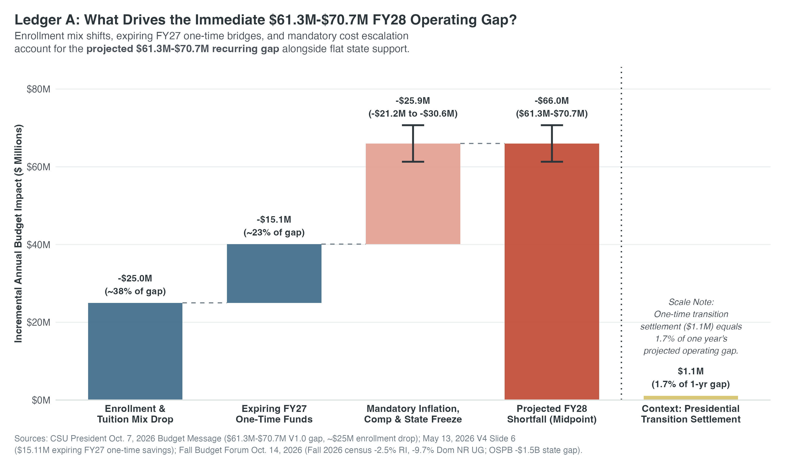
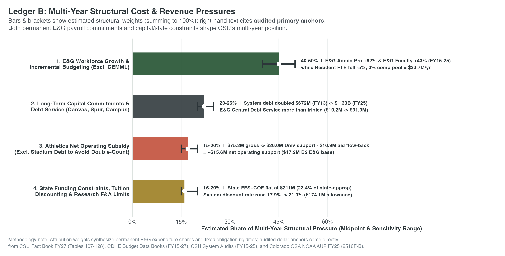
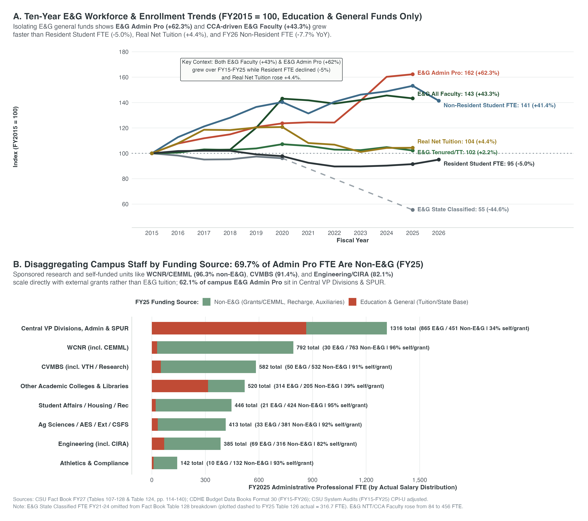
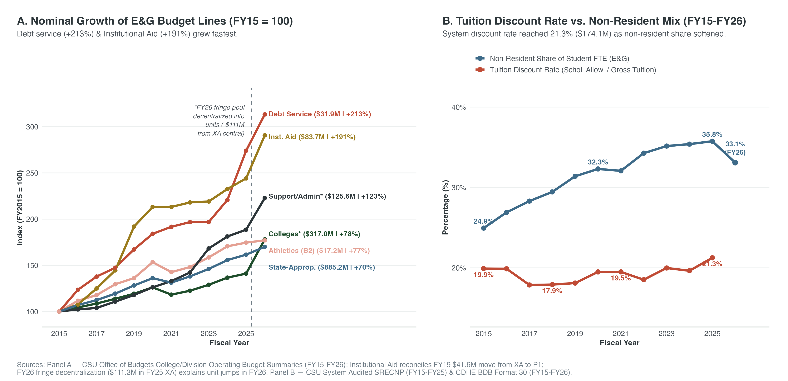
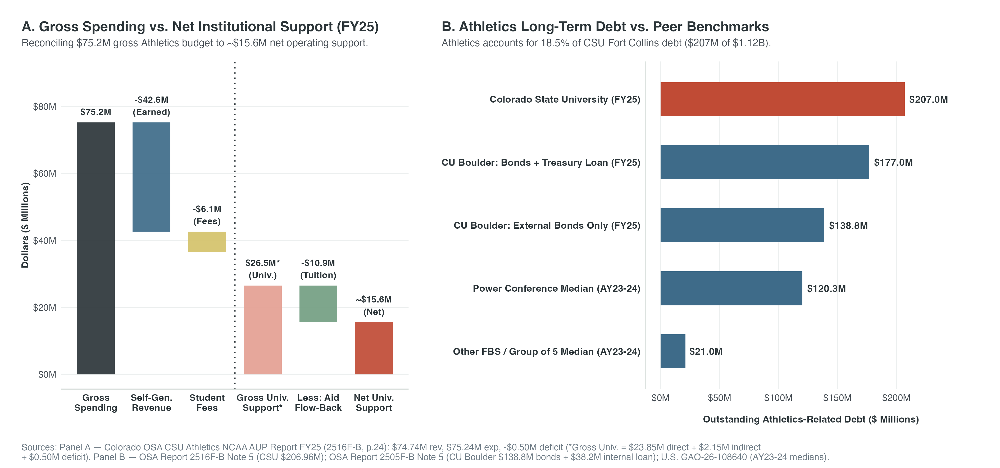
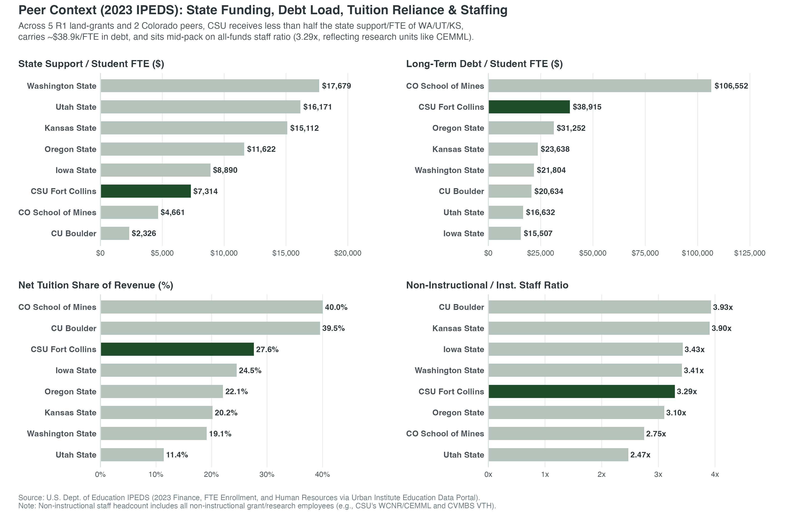

```{r setup}
source("src/report_helpers.R")

fy28_bridge <- load_proc("fy28_shortfall_bridge.csv")
fy27_v4     <- load_proc("fy27_v4_budget_bridge.csv")
fy27_cuts   <- load_proc("fy27_fte_cuts_by_unit.csv")
blame_pie   <- load_proc("structural_blame_pie.csv")
fall_census <- load_proc("fall_census_enrollment_2019_2026.csv")
bdb         <- load_proc("bdb_real_fy17_fy27.csv")
obs_ap      <- load_proc("obs_state_approp_fy24_fy27.csv")
div_shares  <- load_proc("division_budget_shares_fy17_fy26.csv")
wf_totals   <- load_proc("eg_vs_noneg_workforce_totals.csv")
ap_fund     <- load_proc("ap_fte_by_detailed_fund_fy25.csv")
cemml_sum   <- load_proc("cemml_ap_unit_summary_fy25.csv")
audits      <- load_proc("real_audits_fy15_fy25.csv")
ath_hist    <- load_proc("athletics_ncaa_csu_fy19_fy25.csv")
ath_net     <- load_proc("athletics_gross_to_net_fy25.csv")
ath_debt    <- load_proc("athletics_debt_peers.csv")
black_swan  <- load_proc("black_swan_math.csv")
peers       <- load_proc("peer_benchmarks_2023.csv")
manifest    <- load_manifest()

f25 <- wf_totals |> dplyr::filter(fiscal_year == 2025)
f15 <- wf_totals |> dplyr::filter(fiscal_year == 2015)
b15 <- bdb |> dplyr::filter(fiscal_year == 2015)
b26 <- bdb |> dplyr::filter(fiscal_year == 2026, status == "Actual")
b27 <- bdb |> dplyr::filter(fiscal_year == 2027)
au15 <- audits |> dplyr::filter(fiscal_year == 2015)
au25 <- audits |> dplyr::filter(fiscal_year == 2025)
ath25 <- ath_hist |> dplyr::filter(fiscal_year == 2025)
```

# Overview: Separating Near-Term Budget Math from Structural Context

Colorado State University (Fort Collins) enters late-2026 shared governance conversations—ahead of the Nov. 30 AAUP chapter meeting, Dec. 1 Faculty Council, and Dec. 3–4 Board of Governors meetings—facing a projected **\$61.3M to \$70.7M (\$66.0M midpoint)** incremental Education & General (E&G) operating budget gap for FY28 (FY2027–28). That projection follows **\$54.27M** in V4 budget balancing adjustments enacted for FY27, which included **160.58** permanent FTE reductions across academic colleges and support units alongside **\$15.11M** in expiring one-time stopgap savings.

Recent leadership transitions—including Former President Amy Parsons' **\$1.1M** transition settlement and non-disparagement terms, Title IX vetting questions, and **>\$75M** in gross Athletics spending alongside Coach Jim Mora Jr.'s **\$2.4M** base contract—have generated understandable campus concern regarding governance transparency and institutional priorities. At the same time, treating the FY28 shortfall primarily as an executive-settlement or athletics-salary problem merges two separate financial ledgers. Every figure in this brief is traced programmatically to **`r nrow(manifest)` primary public documents and federal datasets** (`data/sources_manifest.csv`) from CSU Office of Budgets, CSU IRP&E Fact Books, CDHE Budget Data Books, CSU System Audited Financial Statements (FY15–FY25), Colorado Office of the State Auditor (OSA) statutory NCAA Agreed-Upon Procedures filings (`2516F-B`, `2505F-B`), BLS CPI-U, and IPEDS.

**Four core empirical findings help ground campus discussion:**

1. **The immediate FY28 gap (\$61.3M–\$70.7M) is driven by enrollment mix shifts, expiring FY27 one-time bridge funds, and payroll/cost inflation.** Declining higher-margin non-resident enrollment accounts for **~\$25.00M (~38%)**, expiring FY27 one-time stopgaps contribute an automatic **\$15.11M (~23%)**, and mandatory cost escalation plus salary pools against flat state support add **\$21.19M–\$30.59M (~39%)**. Adjusting executive settlements or coaching salaries changes that immediate gap by less than 2–4%.
2. **E&G payroll expanded across *both* administrative and instructional lines—while soft-money research staff (CEMML, CIRA, CVMBS) must be separated out fairly.** Across FY15–FY25, all-funds FTE rose 29.7% (7,480.8 to 9,705.9 FTE). Yet of FY25's 4,597.7 Administrative Professional FTE (Fact Book Table 124), **69.7% (3,205.5 FTE)** are funded on **non-E&G sources** (96.3% non-E&G in Warner College/CEMML; 82.1% in Engineering/CIRA) that scale directly with external grants and contracts. On the **E&G general-fund ledger**, however, E&G Admin Pro expanded **+62.3%** (858.1 to 1,392.6 FTE—with **62.1%** housed in Central VP Divisions & SPUR), while E&G faculty expanded **+43.3%** (901.0 to 1,291.0 FTE, driven by +371.9 NTT/CCA FTE vs. +18.1 TT FTE) during a decade when **Resident Student FTE declined -5.0%** (FY15–FY26: 17,535.0 to 16,664.2).
3. **Athletics imposes a meaningful net institutional subsidy (~\$15.57M/yr plus \$206.96M in bonded debt), rather than representing \$75M in redirectable E&G cash.** Out of \$75.24M in FY25 Athletics expenditures (`2516F-B`), \$42.60M (57.0%) comes from self-generated external revenue and \$10.93M returns to CSU as student-athlete tuition, fees, room, and board. Even ending football operations tomorrow would leave **\$206.96M in long-term stadium/athletics bond obligations (18.5% of Fort Collins campus debt)** and ~\$45M–\$50M of the FY28 E&G gap unresolved.
4. **Neither postseason tournament windfalls nor external grant volume directly offsets an E&G instructional shortfall.** Even an NCAA Men's Basketball Final Four run distributes units across ~12 conference members over six years (~\$0.14M/yr net to CSU). Similarly, while CSU System grants and contracts reached \$548.0M in FY25 (\$76.0M Fort Collins IDCR), federal F&A recovery partially reimburses research infrastructure and compliance rather than covering undergraduate instructional deficits under TABOR state caps and a 21.3% institutional tuition discount rate.

---

# Two Separate Ledgers: Immediate FY28 Variance vs. Multi-Year Structure

Viewing CSU's finances through two distinct ledgers helps colleagues across faculty, staff, and administration align on the same empirical baseline. **Ledger A** tracks year-over-year changes moving from FY27 (\$900.98M State Appropriated / E&G baseline) into FY28. **Ledger B** examines the multi-year cost and revenue commitments that narrowed CSU's financial cushion between FY15 and FY26.

## Ledger A: What Triggers the FY28 \$61.3M–\$70.7M Operating Gap?

In the Oct. 7, 2026 campus budget update (reflecting V1.0 Board of Governors review), CSU modeled three scenarios (0%, 1%, and 3% state funding paired with corresponding compensation pools), bracketing an expected FY28 gap of **\$61.3M to \$70.7M**. Cross-referencing that memo with May 13, 2026 V4 closeout slides isolates the three primary drivers:

```{r pdf-ledger-a}
tbl_a <- fy28_bridge |>
  dplyr::mutate(
    Range = ifelse(low_m == high_m, fmt_m(mid_m), paste0(fmt_m(low_m), " – ", fmt_m(high_m))),
    Midpoint = fmt_m(mid_m),
    Share = ifelse(step_order <= 3, fmt_pct(mid_m / 66.00), "100.0%")
  ) |>
  dplyr::select(Driver = driver, Range, Midpoint, `Mid Share` = Share, Source = source_citation)

csu_kable(tbl_a, caption = "Ledger A: Decomposed Incremental Drivers of CSU's Projected FY28 E&G Gap", align = "llrrl") |>
  kableExtra::column_spec(1, width = "1.7in") |>
  kableExtra::column_spec(5, width = "2.2in")
```

{width=96%}

- **1. Enrollment Shifts & Non-Resident Tuition Mix (~\$25.00M, 37.9% of midpoint):** Fall 2026 census slides (Oct. 14 Forum Slides 4–6; Oct. 7 Memo) show Resident Instruction (RI) headcount declined **-2.5% (-703 students, 28,194 to 27,491)**, RI credit hours fell **-2.6% (374,039 to 364,314)**, and RI student FTE fell **-2.5% (12,808.2 to 12,488.0)**. Although CSU welcomed a record Colorado resident freshman class and raised its 4-year graduation rate from 51.1% to 55.1% (graduating continuing students faster), **Domestic Non-Resident Undergraduates declined -9.7% (-685 students)**, **International Undergraduates fell -6.7%**, and **International Graduate enrollment fell -13.9%**. Because non-residents provided **48.7% of Format 30 E&G tuition on 33.1% of student FTE** in FY26 (\$268.9M of \$551.6M), mix losses heavily impact net revenue.
- **2. Expiring FY27 One-Time Stopgaps (\$15.11M, 22.9% of midpoint):** CSU resolved FY27's \$54.27M V4 shortfall using \$36.16M in base reductions (\$7.41M central + \$28.75M campus unit cuts), \$3.00M in vacant position sweeps, and **\$15.112M in one-time savings** (May 13 V4 Slide 6). Because one-time funds expire June 30, 2027, that \$15.11M recurs immediately in FY28.
- **3. Mandatory Cost Escalation, Payroll Pools & State Freeze (\$21.19M–\$30.59M, 39.2% of midpoint):** On a ~\$901M operating base—where FY27's 3% faculty/AP/GA compensation pool, classified mandates, and fringe totaled **\$33.67M**—ongoing benefits, utilities, and compensation growth confront Colorado's September 2026 forecast of up to a **-\$1.5B state FY28 general-fund shortfall** largely absorbed by Medicaid obligations.

## Ledger B: Multi-Year Structural Context

Over FY15–FY26, four concurrent structural commitments left CSU with fewer financial buffers against enrollment variability:

```{r pdf-ledger-b}
tbl_b <- blame_pie |>
  dplyr::mutate(
    `Estimated Weight` = paste0(low_pct, "% – ", high_pct, "%"),
    `Midpoint` = paste0(mid_pct, "%")
  ) |>
  dplyr::select(Factor = driver, `Estimated Weight`, Midpoint, `Audited Primary Anchor` = audited_anchor)

csu_kable(tbl_b, caption = "Ledger B: Multi-Year Structural Pressure Weights Across CSU Finances", align = "lccl") |>
  kableExtra::column_spec(1, width = "1.6in") |>
  kableExtra::column_spec(4, width = "3.1in")
```

{width=96%}

---

# Workforce Growth & Separating Soft-Money Research (CEMML / CIRA)

## Distinguishing Grant-Funded Research Personnel from E&G Overhead

All-funds staff-to-faculty ratios (~3:1 in IPEDS and campus totals) routinely blend **externally funded research and clinical enterprise employees** with **E&G base-budgeted roles**. At CSU, large research and agency units—including Warner College's **Center for Environmental Management of Military Lands (CEMML)**, Engineering's **CIRA**, the **Veterinary Teaching Hospital (VTH)**, and Agricultural Experiment Station / Extension / Colorado State Forest Service divisions—scale directly with external awards and self-supporting contracts rather than general-fund tuition.

CSU Fact Book FY27 (Tables 122–124 & 128) cleanly disaggregates those funds:

- **All-Funds Administrative Professional FTE (4,597.7 FTE in Table 124):** **69.7% (3,205.5 FTE)** are funded outside E&G (Other Funds 1,159.2, Sponsored Programs 871.2, Recharge Centers 735.6, Auxiliaries 439.4).
- **By Fund Group & Unit:** WCNR (including CEMML) employs 792.5 AP FTE, of which **96.3% (762.9 FTE)** are non-E&G; CVMBS is **91.4%** non-E&G; Ag Sciences/AES/Ext/CSFS is **92.1%** non-E&G; and Engineering (including CIRA) is **82.1%** non-E&G. Meanwhile, **Central VP Divisions, Administration & CSU Spur house 864.8 of campus's 1,392.2 E&G AP FTE (62.1%)**.

```{r pdf-cemml}
tbl_cemml <- cemml_sum |>
  dplyr::mutate(
    `E&G FTE` = fmt_n(eg_fte, 1),
    `Non-E&G FTE` = fmt_n(other_funds_fte, 1),
    `Total FTE` = fmt_n(total_fte, 1),
    `Non-E&G %` = fmt_pct(non_eg_share, 1),
    `Campus E&G %` = fmt_pct(eg_share_of_campus_eg, 1)
  ) |>
  dplyr::select(`Organizational Bucket` = macro_bucket, `E&G FTE`, `Non-E&G FTE`, `Total FTE`, `Non-E&G %`, `Campus E&G %`)

csu_kable(tbl_cemml, caption = "FY25 Administrative Professional FTE by Unit Group and Funding Source (CSU Fact Book FY27 Table 124)", align = "lrrrrr", scale_down = TRUE) |>
  kableExtra::column_spec(1, width = "2.1in")
```

{width=96%}

## E&G-Only Expansion Occurred Across Both Administration and Instruction

Looking strictly within **Education & General (E&G)** general funds over FY15–FY25 highlights a shared pattern across both campus administration and academic divisions:

```{r pdf-wf}
tbl_wf <- tibble::tibble(
  `E&G / Student Cohort` = c(
    "E&G Admin Professional FTE",
    "E&G Total Faculty FTE (TTT + NTT/CCA)",
    "   — E&G Tenured & Tenure-Track Faculty",
    "   — E&G NTT / CCA & Adjunct Faculty",
    "E&G Graduate Assistants (FTE)",
    "E&G State Classified Staff (FTE)*",
    "Resident Student FTE (CDHE Format 30)",
    "Non-Resident Student FTE (CDHE Format 30)",
    "CSU System Real Net Tuition (FY25$M)"
  ),
  `FY15` = c(
    fmt_n(f15$eg_admin_pro, 1),
    fmt_n(f15$eg_faculty_total, 1),
    fmt_n(f15$eg_faculty_ttt, 1),
    fmt_n(f15$eg_faculty_ntt, 1),
    fmt_n(704.6, 1),
    fmt_n(f15$eg_state_class, 1),
    fmt_n(b15$resident_fte, 1),
    fmt_n(b15$nonresident_fte, 1),
    fmt_m(au15$real_net_tuition_fy25m, 1)
  ),
  `FY25 / FY26 Actual` = c(
    fmt_n(f25$eg_admin_pro, 1),
    fmt_n(f25$eg_faculty_total, 1),
    fmt_n(f25$eg_faculty_ttt, 1),
    fmt_n(f25$eg_faculty_ntt, 1),
    fmt_n(954.3, 1),
    fmt_n(f25$eg_state_class, 1),
    fmt_n(b26$resident_fte, 1),
    fmt_n(b26$nonresident_fte, 1),
    fmt_m(au25$real_net_tuition_fy25m, 1)
  ),
  `Change (%)` = c(
    fmt_pct((f25$eg_admin_pro - f15$eg_admin_pro) / f15$eg_admin_pro, 1, TRUE),
    fmt_pct((f25$eg_faculty_total - f15$eg_faculty_total) / f15$eg_faculty_total, 1, TRUE),
    fmt_pct((f25$eg_faculty_ttt - f15$eg_faculty_ttt) / f15$eg_faculty_ttt, 1, TRUE),
    fmt_pct((f25$eg_faculty_ntt - f15$eg_faculty_ntt) / f15$eg_faculty_ntt, 1, TRUE),
    fmt_pct((954.3 - 704.6) / 704.6, 1, TRUE),
    fmt_pct((f25$eg_state_class - f15$eg_state_class) / f15$eg_state_class, 1, TRUE),
    fmt_pct((b26$resident_fte - b15$resident_fte) / b15$resident_fte, 1, TRUE),
    fmt_pct((b26$nonresident_fte - b15$nonresident_fte) / b15$nonresident_fte, 1, TRUE),
    fmt_pct((au25$real_net_tuition_fy25m - au15$real_net_tuition_fy25m) / au15$real_net_tuition_fy25m, 1, TRUE)
  )
)

csu_kable(tbl_wf, caption = "Ten-Year E&G Labor Expansion vs. Student Demand and Real Net Tuition (FY15 vs. FY25/FY26)", align = "lrrr")
```

*Note: Fact Book FY27 Table 128 omits FY21–FY24 E&G State Classified FTE rows, reflecting historical Classified-to-AP conversions (571.3 in FY15 to 316.7 in FY25).*

- **Administrative & Instructional Expansion Together:** E&G Admin Pro grew **+534.5 FTE (+62.3%)**—including **+326.3 FTE (+30.6%)** between FY22 and FY25—alongside a `-254.6` FTE reduction in E&G State Classified positions. Over the same span, E&G Faculty rose **+390.0 FTE (+43.3%, 901.0 to 1,291.0)**, driven almost entirely by **Continuing, Contract, and Adjunct (NTT/CCA) appointments rising from 83.7 to 455.6 FTE (+444.3%)**, while Tenured/TT FTE changed by +18.1 (+2.2%) and E&G graduate assistants rose +249.7 (+35.4%).
- **Incremental Budgeting & Slower Real Revenue Growth:** Under CSU's legacy incremental budget model (`Oct. 26 Memo`), base unit allocations rolled forward regardless of credit-hour shifts, while CPI-adjusted **CSU System real net tuition grew +4.4% overall from FY15 to FY25 (\$617.9M to \$644.9M in FY25\$)**—and stood -13.5% below its FY20 real peak (\$746.0M).
- **Distribution of FY27 Reductions:** May 13 V4 Forum disclosures record **160.58 permanent FTE reductions** across 30 units: 91.84 Admin Pro (57.2%), 28.60 State Classified (17.8%), 22.62 Non-TTF (14.1%), and 17.52 TTF (10.9%).

## Tuition Discounting, State Constraints & Research F&A Mechanics

{width=96%}

- **Tuition Discounting:** Across CSU System audits (`audits_system_fy15_fy25`), scholarship allowances rose from \$114.4M (19.9% discount rate in FY15; 17.9% in FY17) to **\$174.1M (21.3% in FY25)**. On Fort Collins' E&G ledger (`bdb_real_fy17_fy27`), institutional aid grew from \$47.2M (FY15) to \$88.5M (FY26) and **\$96.3M estimated for FY27**.
- **State Appropriations:** FY27 State Fee-for-Service (\$161.60M) plus COF stipends (\$49.45M) equal **\$211.05M (23.4% of the \$900.98M State Appropriated / E&G budget)**, flat against FY26 (\$210.94M).
- **Grants & Class Volume:** Although CSU System grants/contracts reached **\$548.0M** in FY25 (`audits`) and Fort Collins IDCR reached **\$76.0M** (`obs`), federal F&A recovery partially offsets research infrastructure, startup costs, and compliance rather than funding general undergraduate instruction.
- **ColOBS Comparability:** Office of Budgets division tables reflect FY19 moving **\$41.64M** in financial aid from `XA Central` into `P1 Enrollment & Access` and FY26 decentralizing **~\$111.26M** of pooled `XA Fringe Benefits` across units. Figure 5 isolates both accounting shifts explicitly.

---

# Athletics Accounting & Long-Term Capital Debt Context

## Gross \$75.24M Spending vs. Net ~\$15.57M Institutional Support

Statutory Colorado OSA NCAA Agreed-Upon Procedures reports (`2516F-B` for FY25) illustrate why gross Athletics expenditures differ substantially from net general-fund operating support:

```{r pdf-ath}
tbl_ath <- ath_net |>
  dplyr::mutate(Amount = fmt_m(amount_m, 2, plus = TRUE)) |>
  dplyr::select(Step = step_id, `Audited Line Item (FY25 OSA 2516F-B)` = component, Amount, Category = category)

csu_kable(tbl_ath, caption = "Gross-to-Net Reconciliation of CSU Athletics Finances, FY25 (Colorado OSA Report 2516F-B)", align = "clrl")
```

{width=96%}

Against **\$75.24M** in FY25 total Athletics spending, **\$42.60M (57.0%)** came from tickets (\$8.17M), donor contributions (\$12.01M), conference/media/NCAA revenue (\$8.17M), sponsorships (\$6.70M), and guarantees/concessions (\$7.54M). Against \$23.85M in direct university support (including \$16.91M `B2` E&G base in FY25, rising to \$17.15M in FY26), \$2.15M indirect support, and \$6.14M student fees, Athletics returned **\$10.93M** to CSU in student-athlete tuition, fees, and housing/dining—resulting in roughly **~\$15.57M net annual institutional operating support** (~\$21.71M including dedicated student fees).

## Capital Debt Overhang (\$206.96M) and Counterfactual Scenarios

- **System & Campus Debt:** Audited CSU System long-term debt grew from \$671.9M (FY13) and \$828.2M (FY14) to \$1,065.1M (FY15), peaked at **\$1,449.3M (FY23)**, stood at **\$1,330.7M (FY25)**, and added **\$79.1M in June 2025 STRATA ATLAS Laser bonds**. Inside Fort Collins E&G, central `XA Debt Service` tripled from \$10.17M (FY15) to **\$31.86M (FY26)** alongside **\$15.00M** budgeted in FY27 for CSU Spur operations and programming (`May 13 V4 Slide 10`).
- **Athletics Debt Benchmarks:** Note 5 of CSU's FY25 OSA AUP (`2516F-B`, p. 26) lists **\$206.96M** in Athletics-allocated debt (**18.5%** of Fort Collins' \$1,118.77M total debt; \$302.63M total future principal + interest; \$14.34M FY25 debt service/leases). Compare **CU Boulder** (`2505F-B`, Note 5: \$138.83M external bonds + \$38.19M internal Treasury loan = **\$177.02M**, 9.6% of CU's \$1,850.29M debt) and **GAO-26-108640** medians (\$120.3M Power-4; \$21.0M Other FBS/G5).

```{r pdf-black-swan}
tbl_bs <- black_swan |>
  dplyr::mutate(
    `CSU Gain` = fmt_m(annual_to_csu_m, 2),
    `% of $66M` = fmt_pct(pct_of_66m_gap, 1)
  ) |>
  dplyr::select(Scenario = scenario, `CSU Gain`, `% of $66M`, Explanation = explanation)

csu_kable(tbl_bs, caption = "Counterfactual Athletics Scenarios Against a $66.0M Midpoint FY28 Gap", align = "lrrl", scale_down = TRUE) |>
  kableExtra::column_spec(1, width = "1.6in") |>
  kableExtra::column_spec(4, width = "2.9in")
```

Ending football operations leaves \$206.96M in stadium bond covenants (~\$10M+/yr debt service) intact and ~\$45M–\$50M of the FY28 E&G gap unresolved; conversely, an NCAA Men's Basketball Final Four run (5 units over 6 years split across ~12 conference members) yields roughly **~\$0.14M/year** to CSU (0.2% of a \$66M gap).

---

# Governance Trust, Source Verification & IPEDS Peers

## Governance Concerns vs. Personnel Record Check

1. **Presidential Transition Settlement (\$1.1M) & Coaching Optics (\$2.4M Base):** Former President Amy Parsons' Oct. 28, 2026 resignation (effective Dec. 31, 2026; \$1.1M settlement with mutual non-disparagement clause) and Coach Jim Mora Jr.'s \$2.4M–\$2.8M contract plus post-WSU remarks generated fair campus criticism around transparency and shared priorities, even though their dollar impact sits below 2–4% of Ledger A.
2. **Source Verification Note (`Jeffrey Lamoureaux`):** Recent commentary cited Title IX investigator Jeffrey Lamoureaux alongside *San Francisco Chronicle* reporting as an example of CSU vetting failures. Primary public records audited for this brief show *SF Chronicle* / UC Berkeley IRP reporting documented Lamoureaux working at **UNL, Eastern Washington, Appalachian State, Goodwin, Auburn, and USF** (citing Colorado solely for state police NDA reform), with **no employment link found at CSU Fort Collins**. Keeping governance critiques anchored on verified CSU filings (`$1.1M` settlement, capital debt approvals, and `Table 128` E&G hiring) strengthens factual credibility.

## Peer Context (IPEDS FY23)

{width=96%}

```{r pdf-peers}
tbl_peers <- peers |>
  dplyr::arrange(dplyr::desc(is_csu), dplyr::desc(debt_per_fte)) |>
  dplyr::mutate(
    FTE = fmt_n(fte_best, 0),
    `State / FTE` = paste0("$", fmt_n(state_per_fte, 0)),
    `Debt / FTE` = paste0("$", fmt_n(debt_per_fte, 0)),
    `Tuition Share` = fmt_pct(tuition_share_rev, 1),
    `Discount Rate` = fmt_pct(tuition_discount_rate, 1),
    `Non-Inst/Inst` = paste0(formatC(noninst_to_inst_ratio, format = "f", digits = 2), "x")
  ) |>
  dplyr::select(Institution = short_name, FTE, `State / FTE`, `Debt / FTE`, `Tuition Share`, `Discount Rate`, `Non-Inst/Inst`)

csu_kable(tbl_peers, caption = "IPEDS FY23 Structural Benchmarks: CSU Fort Collins vs. Colorado & Peer Land-Grants", align = "lrrrrrr", scale_down = TRUE)
```

In IPEDS FY23 (`peer_benchmarks_2023.csv`), CSU received **\$7,314/FTE** in state support—more than triple CU Boulder (\$2,326/FTE), yet less than half of Washington State (\$17,679/FTE), Utah State (\$16,171/FTE), or Kansas State (\$15,112/FTE). CSU carried the highest long-term debt per student among comprehensive R1 land-grants in this group (**\$38,915/FTE**, \$1,118.6M), trailed only specialized Mines (\$106,552/FTE), while sitting mid-pack on all-funds IPEDS staff-to-faculty ratio (**3.29x**, below CU Boulder 3.93x, Kansas State 3.90x, Iowa State 3.43x, and Washington State 3.41x).

---

# Constructive Questions for Campus Dialogue

1. **Review Post-FY22 E&G Central VP Hiring (`62.1%` of E&G AP):** Disaggregate which of the +326 E&G Admin Pro positions added in FY22–FY25 reflect compliance/student support versus central administration—keeping grant-funded WCNR/CEMML and Engineering/CIRA roles clearly separated.
2. **Co-Design Transparent FY28 Hybrid RCM Rules:** Publish clear off-the-top assessments (`XA Debt Service $31.9M`, `CSU Spur $15.0M`), credit-hour weights, and instructional subvention rules ahead of Dec. 3–4 BOG meetings, noting leadership's Oct. 26 acknowledgment that changing budget models creates zero new revenue on its own.
3. **Set Multi-Year Athletics & Capital Debt Guardrails:** Align Athletics' ~\$15.6M net operating subsidy (`B2` \$17.15M baseline) and new debt policies with general-fund capacity.
4. **Report Net Tuition Yield Alongside Enrollment Targets:** Track net revenue per student after institutional discounting (21.3% System discount rate) rather than gross headcounts alone.

---

# How This Brief Was Built & Reality Checks Applied

This brief was framed and reviewed by **Matthew R.V. Ross** (CSU) using **Google DeepMind’s Antigravity** agentic coding environment to construct a reproducible **R (`4.5.2`) + Quarto (`1.10`)** pipeline (`src/00_setup_theme.R`–`src/05_verify_audit.R`). Six verification checks were applied:

1. **Primary-Source Ingestion:** All metrics compute programmatically from **`r nrow(manifest)` SHA-256 verified files and APIs** (`data/sources_manifest.csv`).
2. **Visual Slide Inspection:** Rasterizing 2026 campus forum slides caught blank white tables on Slides 14–15 of the posted Oct. 14 PDF, so Ledger A draws strictly from the Oct. 7 memo and May 13 V4 Slide 6 without estimating missing cells.
3. **Domain Distinction on Soft-Money Research:** Explicitly separated non-E&G research/enterprise AP lines (69.7% campus-wide; 96.3% in WCNR/CEMML) from general-fund E&G trends (`Table 124`).
4. **Accounting Reclassification Controls:** Isolated FY19's \$41.64M financial aid move (`XA` to `P1`) and FY26's ~\$111.26M fringe decentralization in `ColOBS`.
5. **Symmetrical Fact-Checking & Non-Interpolation:** Audited claims on all sides (confirming Parsons/Mora/OSA figures, noting `Jeffrey Lamoureaux`'s public record at other universities, and leaving `FY21–FY24` State Classified rows in `Table 128` as `NA`).
6. **Automated Reconciliation Suite (`src/05_verify_audit.R`):** Seven programmatic checks verify ledger sums, FTE totals, OSA balances, and outputs on every run; documented portal blocks (`HTTP 403` on Knight-Newhouse and `gao.gov`) appear in `DATA_GAPS.md`.
